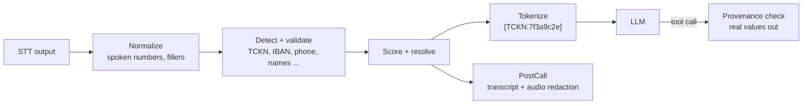

# ortu

[](#license)
[](docs/adr/0001-rust-edition-and-msrv.md)

**PII detection, masking and encryption for Turkish speech and LLM applications.**

ortu sits between speech-to-text and everything downstream of it: LLMs, transcripts, search indexes, analytics and call recordings. It finds personal data the way Turkish callers actually say it, replaces it with keyed tokens before it reaches an LLM, and gives real values back only where they are genuinely needed, such as tool calls and read-back, under checks that stop an LLM from inventing or corrupting them.

> **Status: pre-alpha.** Turkish normalization (M1), the core detectors, scoring, policy and tokens (M2), and sessions with the LLM loop and the Python API (M3) are implemented and verified as a library: v0.1, ready for shadow mode. Nothing is published to crates.io or PyPI yet, and the API will change.

## Why

General-purpose PII tools work on written, well-formed text. Turkish call-center audio is neither:

| What callers do | Example | What ortu does |
|---|---|---|
| Say numbers as words | "on iki üç yüz kırk beş" | Parses spoken numbers into a lattice of readings |
| Split values across turns | "TC'm... bir saniye... 67 89" | Assembles fragments across turns, without holding the conversation back |
| Get misheard by STT | 10 digits instead of 11 | Uses checksums (TCKN, VKN, IBAN, Luhn) to pick the reading STT meant |
| Use Turkish formats | TCKN, VKN, TR IBAN, plates | Ships Turkish validators and gazetteers |
| Talk to an LLM agent | "query my debt" | Tokens for the LLM; real values only at the tool boundary, with provenance checks |

## Use cases

ortu is pre-alpha: the table says what each use case gets from ortu and the milestone that delivers it. Details and the reasoning behind each scope decision are in [systemdesign.md §2.1](docs/systemdesign.md#21-use-cases).

| Use case | What ortu does | Planned in |
|---|---|---|
| **Call-center transcripts** (the starting point): municipalities, hospitals, banks, couriers, any organization talking to citizens or customers by phone | Detects spoken TCKN, IBAN, phone numbers and names in STT output and masks them before transcripts are stored or analyzed | v0.1 (M0-M3), more detectors in M4 |
| **Call recordings** | Beeps out the parts of archived calls where personal data was spoken | M6 |
| **Filter in front of an LLM** (OpenAI, Claude, Gemini and others) | Replaces personal data with tokens before text leaves for the LLM and restores real values in the answer and in tool calls, with provenance checks | M3 (library API); an OpenAI-compatible gateway on `ortu-server` after M10 |
| **Chatbot, webchat and WhatsApp conversations** | The same engine on written text (`Channel::Text`) | M4 (text defaults), full support in v1.x |
| **Emails and support tickets** | Written-channel redaction of incoming mail and ticket text | v1.x |
| **Log scrubbing** | Masks TCKN, phone and card numbers that leaked into application logs, as a batch job | M8 (`ortu redact --format text`) |
| **CI checks** | Fails a build when personal data enters the repository, test fixtures or logs | M8 (`ortu scan --fail-on-pii`, exit code 4) |
| **Training data preparation** | Cleans real customer conversations before they are used to train or fine-tune a model | M8 (batch CLI and Python); indirect identifiers such as job plus district are not detected |
| **OCR output** | Redacts text extracted from scanned documents, forms and petitions | After v1: needs an OCR error model next to the STT one |
| **Moving data to test environments** | Masks free-text fields (notes, transcripts) when copying production data | M8 for free text; structured columns with realistic fake values are out of scope ([D9](docs/systemdesign.md#d9-no-surrogates-in-v1)) |
| **Pseudonymized analytics and reporting** | Reports count and link records per person through tokens, without raw values | M3 (tokens), M8 (batch) |
| **Right to erasure** | Deletes a call's encrypted values or destroys a key period (crypto-shredding) | M5 |
| **Audited access to raw values** | Reveals a value only with a stated reason, and audits every reveal | M5 |

## How it works



- **Rust core** with an embedded Python binding for realtime voice agents and a server for everything else.
- **Recall-first and fail-closed**: on error, no raw text is released.
- **Explainable**: every decision carries the detector, validator, cues and score that produced it; raw values never reach logs.
- **Reproducible**: evaluation on seeded synthetic data, runnable with one command.

## Example

A voice-agent turn loop with a scripted LLM ([examples/voice_agent.py](examples/voice_agent.py), output abridged); everything under "LLM sees" is what leaves for the provider:

```text
caller said     TC'm on sıfır sıfır sıfır sıfır
LLM sees        TC'm [TCKN_INCOMPLETE:282e20fb]

caller said     sıfır sıfır yüz kırk altı
LLM sees        [TCKN:9728d124]
LLM calls       query_debt({"tckn": "[TCKN:9728d124]"})        -> the tool receives 10000000146
tool returns    {"debt_try": 1250, "name": "[NAME:6a6875ca]", ...}   (as the LLM sees it)
LLM replies     Sayın [NAME:6a6875ca], 1250 TL borcunuz var; kimlik numaranız [TCKN:9728d124].
TTS speaks      Sayın Ahmet Yılmaz, 1250 TL borcunuz var; kimlik numaranız *******0146.

invented value  rejected: unknown_value (tckn)
```

```python
import ortu

engine = ortu.Engine(key="...")                       # or keys from ORTU_TOKEN_KEY
session = engine.session(call_id="call-1")
masked = session.push({"speaker": "caller", "text": "TC'm 10000000146"})   # masked["text"] goes to the LLM
args = session.guard_tool_args("query_debt", llm_tool_args)               # real values, or ortu.GuardError
spoken = session.rehydrate(llm_reply)                                    # read-back policy for TTS
post = session.finish()                                                  # persistent transcript
```

The same API exists in Rust (`ortu_stream::Engine`, `Session`); see the crate documentation.

## Documentation

| Document | Contents |
|---|---|
| [docs/systemdesign.md](docs/systemdesign.md) | The design: goals, architecture, data model, milestones, decision log |
| [docs/data-flow.md](docs/data-flow.md) | Every piece of data: origin, form, destination, lifetime, trust zones |
| [docs/algorithms/](docs/algorithms/README.md) | One document per algorithm, with data-flow diagrams and worked examples |
| [docs/adr/](docs/adr/README.md) | Architecture decision records |

## Roadmap

| Milestone | Scope | Status |
|---|---|---|
| M0 | Workspace, quality gate, licenses, project policies | Done |
| M1 | Turkish normalization and the spoken-number lattice | Done |
| M2 | Core detectors (TCKN, phone, IBAN, names), scoring, tokens | Done |
| M3 | Sessions, Realtime/PostCall modes, rehydration, provenance checks, Python API | Done |
| **v0.1** | **Vertical slice, ready for shadow mode** | Ready |
| M4 | Remaining detectors (VKN, cards, email, plates, birth dates, passports, addresses, name gazetteer), Text channel defaults | Next |
| M4b to M10 | Extended Turkish identifiers and health terms (M4b), vault, audio, evaluation, CLI, release, server | Planned |

Details and acceptance criteria: [systemdesign.md, section 17](docs/systemdesign.md#17-milestones-and-acceptance-criteria).

## Verification

Every claim below is a check that ran on the current `main`, on Windows (the maintainer's platform; there is no hosted CI, see [ADR-0003](docs/adr/0003-local-quality-gate.md)).

| Check | Command | Covers |
|---|---|---|
| Quality gate | `cargo xtask check` | rustfmt, Clippy (`pedantic`, warnings as errors), all tests, MSRV 1.85 build, cargo-deny, cargo-audit, and the Python binding's tests and example (`cargo xtask py`) |
| Spoken-number examples | part of the test suite | every example of [systemdesign.md §6.3](docs/systemdesign.md#63-spoken-number-parser), with a snapshot of its full lattice |
| Validators | part of the test suite | the SWIFT IBAN registry example for Turkey; TCKN and IBAN vectors and token values computed by an independent Python implementation, never by the code under test |
| Phone area codes | part of the test suite | the 82 geographic area codes were compared code by code with the numbering plan BTK notified to the ITU on 2 March 2018 ([ITU-T T02020000D60002](https://itu.int/dms_pub/itu-t/oth/02/02/T02020000D60002MSWS.docx)): no difference; tests pin the plan's mobile, MVNO and satellite ranges and reject its non-personal ranges |
| Detection per kind | part of the test suite | at least 20 positive and 20 negative end-to-end cases each for TCKN, IBAN, phone numbers and names, on spoken and written Turkish; written forms such as `TC:10000000146`, `+905321234567`, `0532-123-45-67` and single-word IBANs |
| Sessions and the LLM loop | part of the test suite | the agent-question scenario; values split over two and three turns in Realtime and PostCall; values never finished; PostCall equal to batch redaction; tool results, tool arguments, audit events and read-back |
| Property tests | part of the test suite | idempotent Turkish folding; offsets and digit-to-word maps always inside the input; unambiguous readings reproduced exactly; conflict resolution masks every qualifying candidate, never overlaps labels and ignores input order; corrupted tokens resolve to their own value or fail; identifiers not in the session are rejected at the tool boundary; streaming rehydration equals whole-text rehydration |
| Stress tests | `cargo xtask fuzz` | 1,000,000 seeded random inputs each through normalization, through the validators and full analyzer, and through sessions (Realtime, rehydration, the tool boundary, PostCall), without a panic or invariant violation ([ADR-0005](docs/adr/0005-fuzzing-on-windows.md)) |

Defects these checks found, all fixed with regression tests:

- M1: Turkish folding was not idempotent for `İ` followed by a combining diaeresis; `bir yüz` was read as 100 although Turkish says `yüz`.
- M2: an IBAN written as `TR33 0006 ...` lost its check digits; `adım ııı Barış` missed the name behind the filler; `adım adım ilerliyoruz` took a verb for a name; `ismim Can, borcumu ...` ran the name past the comma.
- M3: values written glued to labels and separators (`TC:10000000146`, `+905321234567`, `0532-123-45-67`, single-word IBANs) were missed; streaming rehydration accepted a token glued to the next chunk's first letter; a value the caller never finished stayed in clear in the persistent transcript; a bot repeating its question broke assembly; a name read back as `Sayın Ahmet Yılmaz` stayed in clear.

Coverage-guided fuzzing (`fuzz/`) has not run yet: it needs Linux or macOS.

## Building from source

Requirements: [rustup](https://rustup.rs) and Python 3.9 or newer. The toolchain version is pinned in `rust-toolchain.toml` and installed automatically; `cargo xtask py` creates `.venv` and installs maturin on first use. On Windows, the MSVC toolchain also needs the Visual Studio C++ build tools and a Windows SDK.

```sh
git clone https://github.com/aral-by/ortu
cd ortu
cargo build --workspace
cargo run -p ortu-cli -- --help
cargo xtask check        # the quality gate every commit passes
cargo xtask py           # build the Python extension, run its tests and the example
```

See [CONTRIBUTING.md](CONTRIBUTING.md) for details on the quality gate.

## KVKK and data minimization

ortu is a **data-minimization layer**: personal data that the next system does not need (an LLM, a transcript store, a search index, analytics, logs, a training set) never reaches it. It supports the KVKK principles of minimization and purpose limitation, the security measures of Article 12 and, with the vault, erasure through crypto-shredding. The mapping is in [systemdesign.md §3.4](docs/systemdesign.md#34-kvkk-alignment-what-ortu-contributes-and-where-it-stops).

What ortu does not do, illustrated by one realistic sentence: *"Ben buranın muhtarı Mehmet Yılmaz, annem kemoterapi gören kadın, anneme personeller çok kötü davranmış, kadın bayılmış"*

- The bot must understand the complaint to route it, so its meaning, including the mother's health, reaches the LLM. ortu masks the name and marks the health term; for services where such content is routine, the LLM has to run in-country or self-hosted.
- "buranın muhtarı" identifies one person even with the name masked. ortu flags unique roles, but indirect identifiers cannot be removed by masking single sentences.
- Audio sent to a cloud STT provider has left before ortu runs.

ortu performs **pseudonymization**: it does not make data anonymous in the legal sense and does not by itself make a system KVKK-compliant. Legal basis, information notices, contracts and retention stay with the data controller. This is not legal advice.

## Origin

ortu is a Belzeka tool. It was conceived in August 2026 out of a production need at the Belzeka call-center platform: protecting Turkish call transcripts before they reach LLMs and persistent systems. Belzeka builds ortu in the open as a vendor-neutral library and uses it in its own products through the same published releases as every other adopter.

## License

Licensed under either of

- Apache License, Version 2.0 ([LICENSE-APACHE](LICENSE-APACHE))
- MIT license ([LICENSE-MIT](LICENSE-MIT))

at your option. See [NOTICE](NOTICE) for attribution.

Unless you explicitly state otherwise, any contribution intentionally submitted for inclusion in this project by you, as defined in the Apache-2.0 license, shall be dual licensed as above, without any additional terms or conditions.
