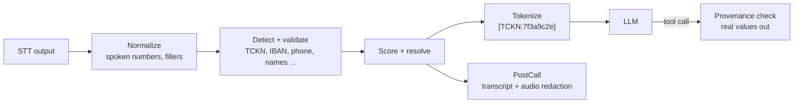

# ortu

[](#license)
[](docs/adr/0001-rust-edition-and-msrv.md)

**PII detection, masking and encryption for Turkish speech and LLM applications.**

ortu sits between speech-to-text and everything downstream of it: LLMs, transcripts, search indexes, analytics and call recordings. It finds personal data the way Turkish callers actually say it, replaces it with keyed tokens before it reaches an LLM, and gives real values back only where they are genuinely needed, such as tool calls and read-back, under checks that stop an LLM from inventing or corrupting them.

> **Status: pre-alpha.** The design is complete and the workspace skeleton (M0) is in place; normalization (M1) is next. Nothing is published to crates.io or PyPI yet, and the API will change.

## Why

General-purpose PII tools work on written, well-formed text. Turkish call-center audio is neither:

| What callers do | Example | What ortu does |
|---|---|---|
| Say numbers as words | "on iki üç yüz kırk beş" | Parses spoken numbers into a lattice of readings |
| Split values across turns | "TC'm... bir saniye... 67 89" | Assembles fragments across turns, without holding the conversation back |
| Get misheard by STT | 10 digits instead of 11 | Uses checksums (TCKN, VKN, IBAN, Luhn) to pick the reading STT meant |
| Use Turkish formats | TCKN, VKN, TR IBAN, plates | Ships Turkish validators and gazetteers |
| Talk to an LLM agent | "query my debt" | Tokens for the LLM; real values only at the tool boundary, with provenance checks |

## How it works



- **Rust core** with an embedded Python binding for realtime voice agents and a server for everything else.
- **Recall-first and fail-closed**: on error, no raw text is released.
- **Explainable**: every decision carries the detector, validator, cues and score that produced it; raw values never reach logs.
- **Reproducible**: evaluation on seeded synthetic data, runnable with one command.

## Documentation

| Document | Contents |
|---|---|
| [docs/systemdesign.md](docs/systemdesign.md) | The design: goals, architecture, data model, milestones, decision log |
| [docs/data-flow.md](docs/data-flow.md) | Every piece of data: origin, form, destination, lifetime, trust zones |
| [docs/algorithms/](docs/algorithms/README.md) | One document per algorithm, with data-flow diagrams and worked examples |
| [docs/adr/](docs/adr/README.md) | Architecture decision records |

## Roadmap

| Milestone | Scope | Status |
|---|---|---|
| M0 | Workspace, quality gate, licenses, project policies | Done |
| M1 | Turkish normalization and the spoken-number lattice | Next |
| M2 | Core detectors (TCKN, phone, IBAN, names), scoring, tokens | Planned |
| M3 | Sessions, Realtime/PostCall modes, rehydration, Python API | Planned |
| **v0.1** | **Vertical slice, ready for shadow mode** | |
| M4 to M10 | Remaining detectors, vault, audio, evaluation, CLI, release, server | Planned |

Details and acceptance criteria: [systemdesign.md, section 17](docs/systemdesign.md#17-milestones-and-acceptance-criteria).

## Building from source

Requirements: [rustup](https://rustup.rs). The toolchain version is pinned in `rust-toolchain.toml` and installed automatically. On Windows, the MSVC toolchain also needs the Visual Studio C++ build tools and a Windows SDK.

```sh
git clone https://github.com/aral-by/ortu
cd ortu
cargo build --workspace
cargo run -p ortu-cli -- --help
cargo xtask check        # the quality gate every commit passes
```

See [CONTRIBUTING.md](CONTRIBUTING.md) for details on the quality gate.

## Legal note

ortu performs **pseudonymization**, which supports KVKK data minimization. It does not make data anonymous in the legal sense, does not by itself make a system KVKK-compliant, and does not protect audio sent to a cloud STT provider before ortu sees it. This is not legal advice.

## Origin

ortu is a Belzeka tool. It was conceived in August 2026 out of a production need at the Belzeka call-center platform: protecting Turkish call transcripts before they reach LLMs and persistent systems. Belzeka builds ortu in the open as a vendor-neutral library and uses it in its own products through the same published releases as every other adopter.

## License

Licensed under either of

- Apache License, Version 2.0 ([LICENSE-APACHE](LICENSE-APACHE))
- MIT license ([LICENSE-MIT](LICENSE-MIT))

at your option. See [NOTICE](NOTICE) for attribution.

Unless you explicitly state otherwise, any contribution intentionally submitted for inclusion in this project by you, as defined in the Apache-2.0 license, shall be dual licensed as above, without any additional terms or conditions.
