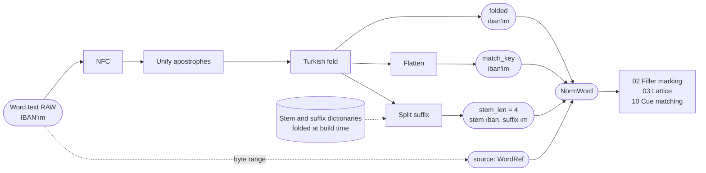
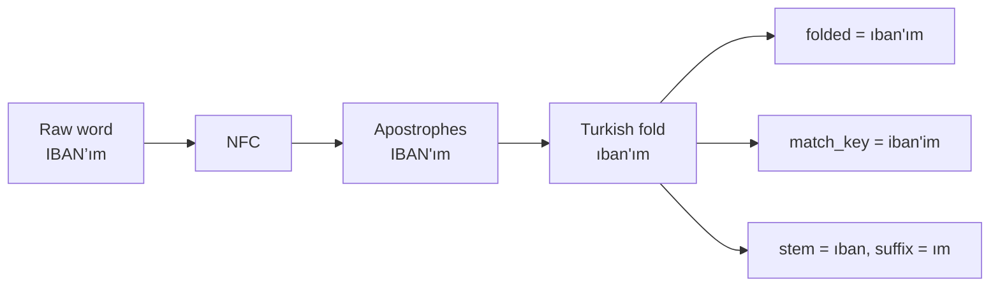

# 01. Text canonicalization

## Purpose

Produce a matching-friendly view of every word (case-folded, Unicode-normalized, suffix-aware) **without modifying the source text**, so that detectors and dictionaries match reliably while every result still maps back to exact source offsets.

## Where it runs

| | |
|---|---|
| Pipeline stage | Normalize (first step) |
| Crate | `ortu-normalize` |
| Modes | Realtime and PostCall |
| Channels | Speech and Text |

## Inputs and outputs

```rust
// Input: the raw words of one turn (never mutated).
&[Word]

// Output: one canonical view per word.
pub struct NormWord {
    pub source: WordRef,          // turn index + word index + byte range
    pub folded: CompactString,    // linguistically correct Turkish lowercase
    pub match_key: CompactString, // folded, then dotless-i and diacritics flattened
    pub stem_len: Option<u16>,    // byte length of the stem when a suffix was split
}
```

Two keys are produced on purpose:

- `folded` is the linguistically correct form. Detectors that care about spelling (email, names on the Text channel) use it.
- `match_key` is a lossy skeleton used for dictionary lookups (number words, cues, fillers), because STT output varies in diacritics: the same word arrives as `üç`, `uc` or `Üç`.

## Data flow



| From | Data | To |
|---|---|---|
| STT via `push` / `redact` | `Word.text` (RAW) | this step; the source is never modified |
| Build-time dictionaries | Folded stems and suffixes | suffix splitter |
| This step | `NormWord.folded` | Text-channel detectors (email, names) |
| This step | `NormWord.match_key` | All dictionary lookups (02, 03, 10) |
| This step | `NormWord.source` | Every later span and audio region |

## Algorithm

```
canonicalize(word):
    s = nfc(word.text)
    s = unify_apostrophes(s)          # U+2019, U+2018, U+00B4, U+0060, U+02BC -> U+0027
    s = turkish_fold(s)
    s, trimmed = trim_edge_punctuation(s)   # keep internal '.', '@', '-', '_'
    folded = s
    match_key = flatten(folded)
    stem_len = split_suffix(folded)
    return NormWord { source, folded, match_key, stem_len }

turkish_fold(s):
    for each char c in s:
        'İ'           -> 'i'
        'I'           -> 'ı'
        'i' + U+0307  -> 'i'          # repair output of non-Turkish lowercasing upstream
        otherwise     -> unicode_lowercase(c)

flatten(s):
    'ı' -> 'i', 'ç' -> 'c', 'ğ' -> 'g', 'ö' -> 'o', 'ş' -> 's', 'ü' -> 'u'

split_suffix(s):
    if s contains '\'':  return position of the apostrophe       # TC'm -> tc + m
    else: longest match of s against the stem dictionary,
          accepted only if the remainder is a known suffix       # numaram -> numara + m
```



**Dictionary rule:** every dictionary (number words, cues, fillers, gazetteers) is passed through the same `turkish_fold` and `flatten` functions **at build time**. Folded forms are never written by hand. This guarantees that `IBAN`, `iban` and `İBAN` all reach the same entry.

**Lookup order:** exact `folded` lookup first; `match_key` lookup only as a fallback, with a prior penalty (see [03](03-spoken-number-lattice.md)). Flattening causes real collisions, for example `ön` (front) and `on` (ten), or `uç` (tip) and `üç` (three). The penalty keeps these collisions from outranking an exact match, while still accepting the far more common case of STT dropping diacritics.

## Worked example

| Raw | `folded` | `match_key` | Stem / suffix |
|---|---|---|---|
| `İSTANBUL` | `istanbul` | `istanbul` | none |
| `IBAN'ım` | `ıban'ım` | `iban'im` | `ıban` / `ım` |
| `TC’m` | `tc'm` | `tc'm` | `tc` / `m` |
| `numaram` | `numaram` | `numaram` | `numara` / `m` |
| `Üç` | `üç` | `uc` | none |
| `uc` | `uc` | `uc` | none (fallback match for `üç`) |

## Complexity

O(n) in the number of bytes per word; no allocation when the word is already canonical (`CompactString` stays inline up to 24 bytes).

## Edge cases

- **Upstream lowercasing:** some STT engines lowercase with non-Turkish rules and emit `i̇` (i plus combining dot). `turkish_fold` repairs it.
- **Acronyms:** `IBAN` folds to `ıban`, which looks wrong but is consistent, because dictionaries are folded by the same function.
- **Mixed tokens:** `12'de` keeps `12` as the stem and `de` as the suffix; the number parser reads the stem.
- **Emails and URLs:** internal punctuation is preserved; only leading and trailing punctuation is trimmed, and the trimmed range is recorded.

## Design rationale

- **Why not use `to_lowercase()`:** it is locale-independent and maps `I` to `i` and `İ` to `i̇`, which is wrong for Turkish and breaks dictionary matching.
- **Why two keys instead of one:** a single linguistic key misses STT variants; a single flattened key causes collisions in places where spelling matters. Two keys with ordered lookup give the recall of the second and the precision of the first.
- **Why never mutate the source:** every downstream result (spans, audio regions, audit evidence) must point to exact source bytes. Canonicalization is a view, not a rewrite.

## Tests and invariants

- `turkish_fold` is idempotent: `fold(fold(s)) == fold(s)`.
- `match_key` is a function of `folded` only.
- Every `NormWord.source` byte range is within the source word.
- Snapshot tests for the table above; proptest over random Unicode strings: no panics, valid UTF-8 boundaries.
