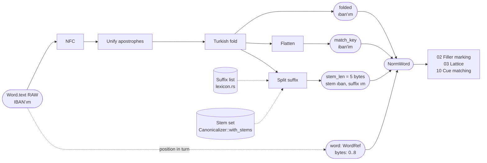
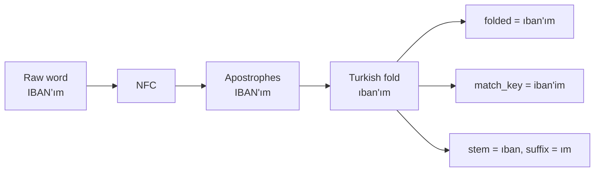

# 01. Text canonicalization

## Purpose

Produce a matching-friendly view of every word (case-folded, Unicode-normalized, suffix-aware) **without modifying the source text**, so that detectors and dictionaries match reliably while every result still maps back to exact source offsets.

## Where it runs

| | |
|---|---|
| Pipeline stage | Normalize (first step) |
| Crate | `ortu-normalize` (`fold.rs`, `canonical.rs`) |
| Modes | Realtime and PostCall |
| Channels | Speech and Text |

## Inputs and outputs

```rust
// Input: the raw words of one turn (never mutated).
&[impl AsRef<str>]

// Output: one canonical view per word.
pub struct NormWord {
    pub word: WordRef,            // index of the word in its turn
    pub bytes: Range<u32>,        // byte range in the turn text (words joined by single spaces)
    pub folded: String,           // linguistically correct Turkish lowercase
    pub match_key: String,        // folded, then dotless-i and diacritics flattened
    pub stem_len: Option<u16>,    // byte length of the stem when a suffix was split
}
```

Two keys are produced on purpose:

- `folded` is the linguistically correct form. Dictionaries (number words, fillers, letter names) match on it, and so do detectors that care about spelling.
- `match_key` is a lossy skeleton. It is consulted **only** for words written without any Turkish-specific letter, which is how STT writes a word when it drops diacritics (`uc` for `üç`). See the lookup rule below.

## Data flow



| From | Data | To |
|---|---|---|
| STT via `push` / `redact` | Raw word text | this step; the source is never modified |
| `lexicon.rs` (compiled in) | Suffix list | suffix splitter |
| Configuration (`Canonicalizer::with_stems`) | Stems to split after | suffix splitter |
| This step | `NormWord.folded` | Dictionary lookups (02, 03, spelling), Text-channel detectors |
| This step | `NormWord.match_key` | Fallback number lookups for plain-ASCII words (03) |
| This step | `NormWord.word`, `NormWord.bytes` | Every later span and audio region |

## Algorithm

```
canonicalize(words):
    offset = 0
    for (index, raw) in words:
        bytes = offset .. offset + len(raw); offset = bytes.end + 1
        folded = trim_edge_punctuation(turkish_fold(raw))   # keep internal '.', '@', '-', '_'
        match_key = flatten(folded)
        stem_len = split_suffix(folded)
        yield NormWord { word: index, bytes, folded, match_key, stem_len }

turkish_fold(s):
    for each char c in nfc(s):
        'İ'                   -> 'i'
        'I'                   -> 'ı'
        U+0307 after 'i'      -> (dropped)   # repair output of non-Turkish lowercasing upstream
        U+2019, U+2018, U+00B4, U+0060, U+02BC -> '\''
        otherwise             -> unicode_lowercase(c)

flatten(s):
    'ı', 'î' -> 'i';  'ç' -> 'c';  'ğ' -> 'g';  'ö' -> 'o';  'ş' -> 's';  'ü', 'û' -> 'u';  'â' -> 'a'

split_suffix(s):
    if s contains '\'':  return position of the apostrophe       # TC'm -> tc + m
    else: longest stem-set prefix of s whose remainder
          is in the suffix list                                  # numaram -> numara + m
```



**Dictionary rule:** every Turkish word list lives in `crates/ortu-normalize/src/lexicon.rs` and is written in folded form. A test folds every entry and fails if the result differs, so `IBAN`, `iban` and `İBAN` can never become separate entries (ADR-0004).

**Written values:** `NormWord::written_value()` reads the value inside a word of written text, where values are glued to labels and separators: a label before the last `:` or `=` is dropped, and a leading `+` and hyphens are removed. It returns a value only if ASCII letters and digits remain. `TC:10000000146` gives `10000000146`, `+905321234567` gives `905321234567`, `0532-123-45-67` gives `05321234567`, and `IBAN:TR33-0006` gives `tr330006`. The lattice reads digit-only results as digit groups ([03](03-spoken-number-lattice.md)); the IBAN detector reads `tr` plus 24 digits as a written IBAN ([06](06-iban-validation.md)). Like every other view, it never changes the source (ADR-0008).

**Lookup rule:** exact lookup on the folded stem first. The flattened `match_key` is consulted only when the word contains **no** Turkish-specific letter (`folded == match_key`), and a hit through it costs `FALLBACK_COST` in the lattice ([03](03-spoken-number-lattice.md)). This keeps `uc` (STT dropped the diacritics) readable as `üç` while `uç` ("tip") and `ön` ("front") are never read as numbers: a word written with Turkish letters was meant as written.

## Worked example

| Raw | `folded` | `match_key` | Stem / suffix | Number word? |
|---|---|---|---|---|
| `İSTANBUL` | `istanbul` | `istanbul` | none | no |
| `IBAN’ım` | `ıban'ım` | `iban'im` | `ıban` / `ım` | no |
| `TC’m` | `tc'm` | `tc'm` | `tc` / `m` | no |
| `numaram` (stem `numara` configured) | `numaram` | `numaram` | `numara` / `m` | no |
| `Üç` | `üç` | `uc` | none | yes, exact |
| `uc` | `uc` | `uc` | none | yes, through the fallback |
| `uç` | `uç` | `uc` | none | no: contains `ç` |
| `TC:10000000146` | `tc:10000000146` | `tc:10000000146` | none | yes: written value `10000000146` |
| `0532-123-45-67` | `0532-123-45-67` | `0532-123-45-67` | none | yes: written value `05321234567` |

## Complexity

O(n) in the number of bytes per word, plus one allocation each for `folded` and `match_key`. Small-string optimizations wait for the M7 benchmarks (ADR-0004).

## Edge cases

- **Upstream lowercasing:** some STT engines lowercase with non-Turkish rules and emit `i̇` (i plus combining dot). `turkish_fold` repairs it.
- **Acronyms:** `IBAN` folds to `ıban`, which looks wrong but is consistent, because dictionary entries are folded by the same function.
- **Mixed tokens:** `12'de` keeps `12` as the stem and `de` as the suffix; the number parser reads the stem.
- **Emails and URLs:** internal punctuation is preserved; only leading and trailing punctuation is trimmed. `bytes` always covers the raw word, trimmed punctuation included, so a masked span never leaves a fragment behind.
- **Punctuation-only tokens** (`...`) fold to an empty string and are marked as fillers ([02](02-filler-and-correction-marking.md)).

## Design rationale

- **Why not use `to_lowercase()`:** it is locale-independent and maps `I` to `i` and `İ` to `i̇`, which is wrong for Turkish and breaks dictionary matching.
- **Why two keys instead of one:** a single linguistic key misses STT variants; a single flattened key causes collisions (`ön`/`on`, `uç`/`üç`). Restricting the flattened key to plain-ASCII words gives the recall of the first case without the false readings of the second.
- **Why never mutate the source:** every downstream result (spans, audio regions, audit evidence) must point to exact source bytes. Canonicalization is a view, not a rewrite.

## Tests and invariants

- `turkish_fold` is idempotent: `fold(fold(s)) == fold(s)` (proptest over random Unicode strings).
- `match_key` is a function of `folded` only.
- Every `NormWord.bytes` lies within the turn text (proptest), and slicing the turn text with it returns the raw word (unit test).
- Every `lexicon.rs` entry is in folded form; keyed tables have no duplicate keys.
- Unit tests for every row of the table above, and Text-channel end-to-end cases for written TCKNs, IBANs and phone numbers (`crates/ortu-tr/tests/text_channel.rs`).
