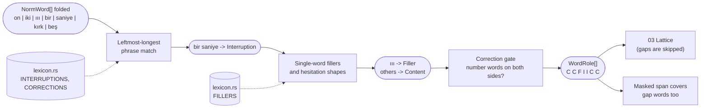
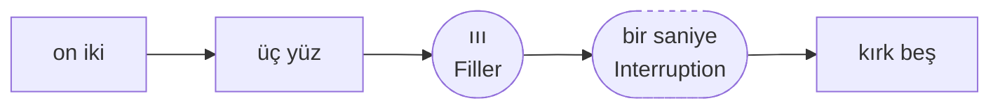

# 02. Filler and correction marking

## Purpose

Spoken PII is interrupted: *"on iki üç yüz... ııı... bir saniye... kırk beş"* ("twelve three hundred... uh... one second... forty-five"). This step tags every word with its conversational role so that the number parser can **skip** fillers and interruptions without losing the run, and can recognize **corrections** that override an earlier value.

## Where it runs

| | |
|---|---|
| Pipeline stage | Normalize (after canonicalization) |
| Crate | `ortu-normalize` (`roles.rs`; word lists in `lexicon.rs`) |
| Modes | Realtime and PostCall |
| Channels | Speech (Text: corrections only) |

## Inputs and outputs

```rust
// Input
&[NormWord]

// Output: one role per word; words are marked, never removed.
pub enum WordRole {
    Content,
    Filler,        // şey, yani, işte; hesitations ııı, eee, hmm; punctuation-only tokens
    Interruption,  // bir saniye, bir dakika, dur, şöyle, bakayım, bakalım
    Correction,    // yok yok, pardon, hayır (only between two digit runs)
}
```

## Data flow



| From | Data | To |
|---|---|---|
| 01 | `NormWord[].folded`, `match_key` | phrase matching (folded), hesitation shapes (match key) |
| `lexicon.rs` | Phrases, fillers, correction markers | matchers |
| This step | `WordRole[]` | 03 (gap skipping, run boundaries, overrides), spelling, 12 (corrections across turns) |
| This step via 03 | `DigitLattice.overrides` (run B overrides run A) | `Evidence.normalization` (audit) |

## Algorithm

```
mark_roles(words):
    roles = [Content; n]
    i = 0
    while i < n:
        # 1. Multi-word phrases first, leftmost-longest, on folded forms.
        if a phrase from INTERRUPTIONS or CORRECTIONS starts at i (longest wins):
            tag its words with the phrase's role; i += phrase length
        # 2. Single-word fillers.
        else:
            if folded is empty, or folded in FILLERS, or match_key is a hesitation shape:
                roles[i] = Filler
            i += 1

    # 3. Correction markers are only corrections in a numeric context.
    for each maximal span p of Correction words:
        if a number word lies within 2 words before p
           and a number word lies within 2 words after p:
            keep Correction
        else:
            retag p as Content      # "hayır" as a plain "no" answer

hesitation shape (on match_key):
    a repeated vowel or hum of length >= 2 (ii, eee, aaa, mm), or h followed by m's (hm, hmm)
```

The number parser ([03](03-spoken-number-lattice.md)) then treats `Filler` and `Interruption` words as **skippable gaps**:

```
a digit run continues across at most max_gap_tokens (default 4)
consecutive Filler/Interruption words;
any Content word that is not a number word ends the run;
a Correction ends the run and links the next run to it.
```



One run is formed over all nine words. Its best reading is `12345`: the gap does not close the open group, so `kırk beş` completes `üç yüz`. The dashed words are part of the masked span but contribute no digits.

### Corrections

```
"beş üç iki ... yok yok , beş üç üç"
 run A = 532      Correction     run B = 533    (run B: overrides = Some(A))
```

- Run B **overrides** run A as the value; `DigitLattice::overrides` carries the link and the audit trail records it.
- **Both** runs are masked. Run A may itself be PII (the caller may have been right the first time).

## Complexity

O(n * p) per turn, with n words and p phrases. The phrase list has fewer than twenty entries, so a direct scan beats building an automaton; Aho-Corasick is introduced with the large gazetteers in `ortu-tr`.

## Edge cases

- **`bir saniye` vs. the number one:** the phrase match runs first and claims `bir`, so it does not become the digit `1`. In a numeric context, "one second" is almost always an interruption.
- **`hayır` / `pardon` outside numbers:** without number words on both sides they are ordinary content.
- **Diacritic-free variants** are listed explicitly in `lexicon.rs`, and only where they collide with no other word: `şöyle` ("like this") has no `soyle` variant because `söyle` ("say") would match it too.
- **Single letters** (`e`, `a`) are words, not hesitations; a hesitation needs at least two characters.
- **Punctuation-only tokens** (`...`, `,`) are fillers: they carry no content and must not end a run.
- **Long pauses:** STT may split an interruption into a separate turn; cross-turn continuation is handled in [12](12-cross-turn-assembly.md), not here.
- **Gap limit exceeded:** the run closes. Over-long gaps usually mean the topic changed.

## Design rationale

- **Mark, never delete:** deleting words would break offsets, audio regions and the audit trail. Marking keeps the source intact and lets the masked span cover the fillers too, so no partial information leaks between digits.
- **Context-gated corrections:** a global rule that every `hayır` is a correction would split legitimate runs and override correct values.
- **Fixed gap budget instead of a learned model:** the budget is explainable, easy to tune from evaluation data, and fails predictably.
- **Word lists as data:** the lists live in `lexicon.rs` so that the Turkish data can be reviewed without reading the rules (ADR-0004).

## Tests and invariants

- The number of roles equals the number of words; source ranges are untouched (proptest).
- Unit tests: phrase precedence over digits, gated and ungated corrections, hesitations, punctuation-only tokens.
- Lattice tests: fillers inside a run, gap limit exceeded, correction links.
- Planned (M7): the synthetic generator injects fillers and interruptions at random positions; recall on those samples is reported separately.
