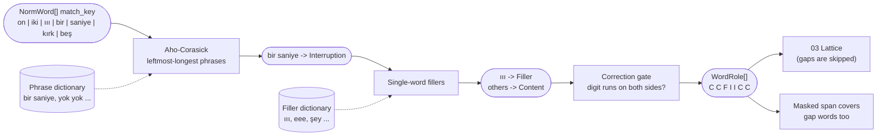

# 02. Filler and correction marking

## Purpose

Spoken PII is interrupted: *"on iki üç yüz... ııı... bir saniye... kırk beş"* ("twelve three hundred... uh... one second... forty-five"). This step tags every word with its conversational role so that the number parser can **skip** fillers and interruptions without losing the run, and can recognize **corrections** that override an earlier value.

## Where it runs

| | |
|---|---|
| Pipeline stage | Normalize (after canonicalization) |
| Crate | `ortu-normalize` |
| Modes | Realtime and PostCall |
| Channels | Speech (Text: corrections only) |

## Inputs and outputs

```rust
// Input
&[NormWord]

// Output: one tag per word; words are marked, never removed.
pub enum WordRole {
    Content,
    Filler,        // ııı, eee, hmm, şey, yani, işte
    Interruption,  // bir saniye, bir dakika, dur, şöyle, bakayım
    Correction,    // yok yok, pardon, hayır (only between two digit runs)
}
```

## Data flow



| From | Data | To |
|---|---|---|
| 01 | `NormWord[].match_key` | phrase and filler matching |
| Dictionaries | Phrases, fillers, correction markers | matchers |
| This step | `WordRole[]` | 03 (gap skipping, run boundaries), 12 (corrections across turns) |
| This step | Correction links (run B overrides run A) | `Evidence.normalization` (audit) |

## Algorithm

```
mark(words):
    # 1. Multi-word phrases first, leftmost-longest, on match_key.
    for match in aho_corasick_leftmost_longest(PHRASES, words.match_key):
        tag every word in match with match.role

    # 2. Single-word fillers.
    for w in words where role is unset:
        if w.match_key in FILLERS: w.role = Filler
        else:                      w.role = Content

    # 3. Correction markers are only corrections in a numeric context.
    for each phrase p tagged Correction:
        if digit_run_ends_within(p, before = 2 words)
           and digit_run_starts_within(p, after = 2 words):
            keep Correction
        else:
            retag p as Content      # "hayır" as a plain "no" answer
```

The number parser ([03](03-spoken-number-lattice.md)) then treats `Filler` and `Interruption` words as **skippable gaps**:

```
a digit run continues across at most max_gap_tokens (default 4)
consecutive Filler/Interruption words;
any Content word that is not a number word ends the run.
```


One digit run `12 300 45` is formed (subject to the lattice); the dashed words are part of the masked span but contribute no digits.

### Corrections

```
"beş üç iki ... yok yok , beş üç üç"
 run A = 532      Correction     run B = 533
```

- Run B **overrides** run A as the value (`Evidence.normalization` records the override).
- **Both** runs are masked. Run A may itself be PII (the caller may have been right the first time).

## Complexity

O(n + m) per turn with Aho-Corasick (n words, m matches); the automaton is built once at startup.

## Edge cases

- **`bir saniye` vs. the number one:** the phrase match runs first and claims `bir`, so it does not become the digit `1`. In a numeric context, "one second" is almost always an interruption.
- **`hayır` / `pardon` outside numbers:** without digit runs on both sides they are ordinary content.
- **Long pauses:** STT may split an interruption into a separate turn; cross-turn continuation is handled in [12](12-cross-turn-assembly.md), not here.
- **Gap limit exceeded:** the run closes. Over-long gaps usually mean the topic changed.

## Design rationale

- **Mark, never delete:** deleting words would break offsets, audio regions and the audit trail. Marking keeps the source intact and lets the masked span cover the fillers too, so no partial information leaks between digits.
- **Context-gated corrections:** a global rule that every `hayır` is a correction would split legitimate runs and override correct values.
- **Fixed gap budget instead of a learned model:** the budget is explainable, easy to tune from evaluation data, and fails predictably.

## Tests and invariants

- The number of words and their source ranges are unchanged by marking.
- Every phrase in the dictionaries is tested in isolation and inside a digit run.
- Synthetic generator injects fillers and interruptions at random positions; recall on those samples is reported separately in the evaluation.
