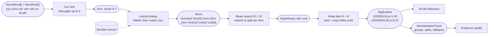
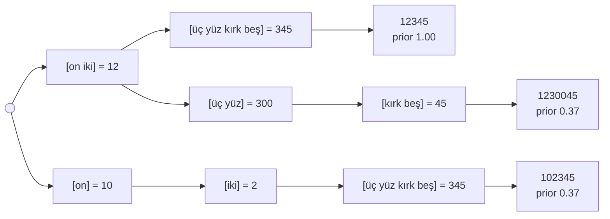

# 03. Spoken number lattice

## Purpose

Turn spoken Turkish numbers into digit strings. Spoken numbers are ambiguous: *"yüz yirmi"* is `120` if read as one number, or `10020` if the speaker meant "one hundred, twenty" as two groups. Instead of guessing, the parser returns a small **lattice** of readings with prior scores, and lets the validators decide (decision D4).

## Where it runs

| | |
|---|---|
| Pipeline stage | Normalize (last step) |
| Crate | `ortu-normalize` |
| Modes | Realtime and PostCall |
| Channels | Speech (Text: digit tokens and written-out numbers) |

## Inputs and outputs

```rust
// Input: canonicalized, role-tagged words of one turn.
&[NormWord], &[WordRole]

// Output: per digit run, at most K readings ordered by prior.
pub struct DigitLattice {
    pub run: Range<u32>,             // word indices covered by the run
    pub readings: SmallVec<[DigitRun; 8]>,
}

pub struct DigitRun {
    pub digits: SmallString<[u8; 32]>,
    pub source: Vec<WordRef>,        // digits[i] -> source word
    pub prior: f32,                  // 0.0..=1.0, relative to the best reading
    pub trace: NormalizationTrace,   // group boundaries, fallback lookups
}
```

## Lexical classes

| Class | Words (data) | Magnitude |
|---|---|---|
| `Zero` | sıfır | always its own group |
| `Unit(v)` | bir ... dokuz | 0 |
| `Ten(v)` | on, yirmi ... doksan | 1 |
| `Hundred` | yüz | 2 |
| `Thousand` | bin | 3 (scales the group) |
| `Million`, `Billion` | milyon, milyar | 6, 9 (scales the group) |
| `DigitToken(s)` | `12`, `5`, stem of `12'de` | literal, its own group |

Lookups use `folded` first and `match_key` as a fallback ([01](01-text-canonicalization.md)); a fallback lookup adds `c_fallback` to the reading's cost.

## Data flow



| From | Data | To |
|---|---|---|
| 01, 02 | Words with roles | run cutter |
| Number lexicon | Word classes and magnitudes | lexical lookup |
| This step | `DigitLattice` (readings, priors, digit-to-word map) | 04 TCKN, 05 VKN, 06 IBAN, 07 cards, 08 phone and plate |
| This step | `NormalizationTrace` | `Evidence` (which reading was chosen and why) |

## Algorithm

A beam search over the words of a run. Each hypothesis holds the digits emitted so far, the open group, and an accumulated cost.

```
parse_run(items):                      # number words of one run, gaps already skipped
    beam = [ Hyp { digits: "", group: None, cost: 0 } ]
    for item in items:
        next = []
        for h in beam:
            if h.group can_extend_with(item):
                next.push(h.extend(item))                     # cost += 0
                next.push(h.close().open(item) + c_split)     # forced split
            else:
                next.push(h.close().open(item))               # natural boundary, cost += 0
        beam = best B of next by cost       # B = 32
    finals = [ h.close() for h in beam ]
    keep best K distinct digit strings      # K = 8
    prior(h) = exp(-(h.cost - best.cost))

can_extend_with(group, item):
    magnitude(item) < smallest filled magnitude of group
    or (item is Hundred and group holds a single Unit)        # "üç yüz"
    or (item is Thousand/Million/Billion and group has no scale yet)

close(group):
    render the group's value in decimal, append to digits
```

Cost constants (initial values, calibrated in M7):

| Constant | Value | Meaning |
|---|---|---|
| `c_split` | 1.0 | a split where the grammar allowed extension |
| `c_fallback` | 0.7 | a word matched only through `match_key` |

## Worked example 1: natural grouping

Input: `on iki üç yüz kırk beş` ("twelve three hundred forty-five")



| Reading | Groups | Splits forced | Prior |
|---|---|---|---|
| `12345` | 12 / 345 | 0 | 1.00 |
| `102345` | 10 / 2 / 345 | 1 | 0.37 |
| `1230045` | 12 / 300 / 45 | 1 | 0.37 |
| `123405` | 12 / 340 / 5 | 1 | 0.37 |
| ... | | | |

## Worked example 2: the checksum as an oracle

The caller reads the synthetic TCKN `10020000126` as "one hundred, twenty, zero, zero, zero, twelve, six", and STT drops the pause:

```
yüz yirmi sıfır sıfır sıfır on iki altı
```

| Reading | Groups | Digits | Length | TCKN validator |
|---|---|---|---|---|
| natural (prior 1.00) | 120 / 0 / 0 / 0 / 12 / 6 | `120000126` | 9 | fail (length) |
| one forced split (prior 0.37) | 100 / 20 / 0 / 0 / 0 / 12 / 6 | `10020000126` | 11 | **pass** |

The TCKN detector picks the validated reading despite its lower prior ([04](04-tckn-validation.md)). With a single-best parser, this value would have been lost before any validator saw it.

## Complexity

O(n * B) per run with n number words and beam width B = 32; output bounded by K = 8. In practice runs are short (an IBAN read in groups is the longest common case, about 15 words).

## Edge cases

- **Years and dates:** `iki bin yirmi dört` is one group `2024`; date detectors use it, ID detectors ignore it.
- **`bir` as an article:** `bir` followed by a non-number word is not a digit run of its own unless a cue is present.
- **Homophones:** `altı` (six) vs. `aldı` (took), `on` (ten) vs. `onu` (it). Handled by the STT noise model in evaluation and by the fallback penalty, not by special cases here.
- **Very long runs:** beam pruning keeps the cost bounded; the run is never truncated.

## Design rationale

- **Lattice instead of a single parse:** the validators carry far more information than any grammar prior. Committing early discards information before the component that could use it ever sees it.
- **Beam search instead of full enumeration:** the number of segmentations grows exponentially with run length; a beam keeps latency within the p99 budget with negligible loss, because readings with many forced splits are never the intended ones.
- **Cost model instead of probabilities:** costs are additive and explainable ("one forced split, one fallback lookup") and are recorded in `NormalizationTrace` for the audit trail.

## Tests and invariants

- Every example in the design document's §6.3 table is a snapshot test.
- For every reading, `digits.len() == source.len()` and each `source[i]` is inside the run.
- Proptest: render a random digit string with a random reading style (digit by digit, groups of 2, 3 or 4); the original string must appear among the K readings.
- Fuzzing (`parse_spoken_number`): no panic over 1M iterations.
