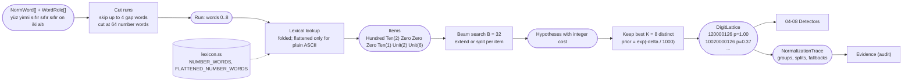
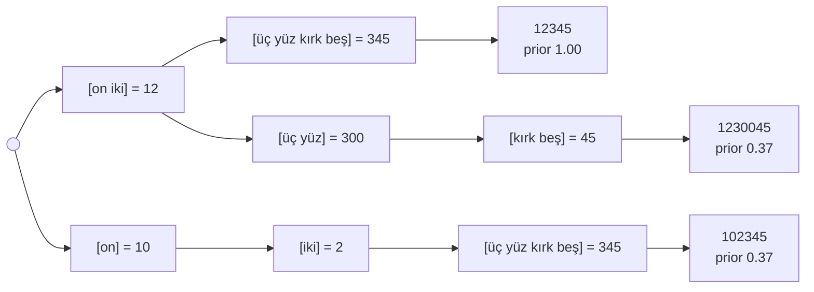

# 03. Spoken number lattice

## Purpose

Turn spoken Turkish numbers into digit strings. Spoken numbers are ambiguous: *"yüz yirmi"* is `120` if read as one number, or `10020` if the speaker meant "one hundred, twenty" as two groups. Instead of guessing, the parser returns a small **lattice** of readings with prior scores, and lets the validators decide (decision D4).

## Where it runs

| | |
|---|---|
| Pipeline stage | Normalize (last step) |
| Crate | `ortu-normalize` (`number.rs`; number words in `lexicon.rs`) |
| Modes | Realtime and PostCall |
| Channels | Speech (Text: digit tokens and written-out numbers) |

## Inputs and outputs

```rust
// Input: canonicalized, role-tagged words of one turn.
&[NormWord], &[WordRole], &LatticeConfig

// Output: one lattice per run of number words, at most K readings each.
pub struct DigitLattice {
    pub words: Range<u32>,           // word indices covered by the run
    pub readings: Vec<DigitRun>,     // best first, never empty
    pub overrides: Option<usize>,    // the earlier run this one corrects (02)
}

pub struct DigitRun {
    pub digits: String,
    pub source: Vec<WordRef>,        // digits[i] -> source word
    pub prior: f32,                  // exp(-(cost - best cost)), 1.0 for the best reading
    pub trace: NormalizationTrace,   // group boundaries, forced splits, fallbacks, cost
}

pub struct LatticeConfig { beam_width: 32, max_readings: 8, max_gap_tokens: 4 }
```

## Lexical classes

| Class | Words (data in `lexicon.rs`) | Magnitude |
|---|---|---|
| `Zero` | sıfır | always its own group |
| `Unit(v)` | bir ... dokuz | 0 |
| `Ten(v)` | on, yirmi ... doksan | 1 |
| `Hundred` | yüz | 2 |
| `Scale(3)` | bin | scales the group by 10^3 |
| `Scale(6)`, `Scale(9)` | milyon, milyar | scale the group by 10^6, 10^9 |
| `Digits(s)` | `12`, `0532`, stem of `12'de` (up to 32 digits) | literal, its own group |

Lookups use the folded stem. The flattened table (`uc`, `dort`, `kirk`, ...) is consulted only for words written without any Turkish-specific letter, and each such hit adds `FALLBACK_COST` to the reading ([01](01-text-canonicalization.md), ADR-0004).

## Data flow



| From | Data | To |
|---|---|---|
| 01, 02 | Words with roles | run cutter |
| `lexicon.rs` | Word classes and magnitudes | lexical lookup |
| `LatticeConfig` | Beam width, readings per run, gap budget | run cutter, beam search |
| This step | `DigitLattice` (readings, priors, digit-to-word map, overrides) | 04 TCKN, 05 VKN, 06 IBAN, 07 cards, 08 phone and plate |
| This step | `NormalizationTrace` | `Evidence` (which reading was chosen and why) |

## Algorithm

A beam search over the words of a run. Each hypothesis holds the digits emitted so far, the open group, and an accumulated integer cost.

```
parse_run(items):                      # number words of one run, gaps already skipped
    beam = [ Hyp { digits: "", group: None, cost: 0 } ]
    for item in items:
        next = []
        for h in beam:
            if item.fallback: h.cost += FALLBACK_COST
            if h.group can_extend_with(item):
                next.push(h.extend(item))                        # cost += 0
                next.push(h.close().open(item) + SPLIT_COST)     # forced split
            else:
                next.push(h.close().open(item))                  # natural boundary, cost += 0
        beam = best B of next by cost, stable, distinct (digits, open group)    # B = 32
    finals = [ h.close() for h in beam ]
    keep best K distinct digit strings                           # K = 8
    prior(h) = exp(-(h.cost - best.cost) / 1000)

can_extend_with(group, item):           # Turkish numbers compose from large to small
    Unit:    no units yet, and tens or hundreds or a scale already present
    Ten:     no tens or units yet, and hundreds or a scale already present
    Hundred: no hundreds or tens yet, and a unit >= 2 to multiply ("üç yüz")
             or an empty segment after a scale ("bin yüz")
    Scale:   the current segment is not empty, is not a lone "bir" before "bin",
             and the scale is smaller than the last one
    Zero, Digits: never

close(group):
    render the group's digits and append them; a position no word set
    (the zeros of "üç yüz") is attributed to the nearest word setting a higher position
```

Cost constants (integers in thousandths so that ordering is exact; calibrated in M7):

| Constant | Value | Meaning |
|---|---|---|
| `SPLIT_COST` | 1000 | a split where the grammar allowed extension |
| `FALLBACK_COST` | 700 | a word matched only through the flattened table |

## Worked example 1: natural grouping

Input: `on iki üç yüz kırk beş` ("twelve three hundred forty-five")



| Reading | Groups | Splits forced | Prior |
|---|---|---|---|
| `12345` | 12 / 345 | 0 | 1.00 |
| `123405` | 12 / 340 / 5 | 1 | 0.37 |
| `1230045` | 12 / 300 / 45 | 1 | 0.37 |
| `123145` | 12 / 3 / 145 | 1 | 0.37 |
| `102345` | 10 / 2 / 345 | 1 | 0.37 |
| `12300405` | 12 / 300 / 40 / 5 | 2 | 0.14 |
| ... | | | |

This table is the recorded snapshot `crates/ortu-normalize/tests/snapshots/lattice__twelve_three_hundred_forty_five.snap`.

## Worked example 2: the checksum as an oracle

The caller reads the synthetic TCKN `10020000126` as "one hundred, twenty, zero, zero, zero, twelve, six", and STT drops the pause:

```
yüz yirmi sıfır sıfır sıfır on iki altı
```

| Reading | Groups | Digits | Length | TCKN validator |
|---|---|---|---|---|
| natural (prior 1.00) | 120 / 0 / 0 / 0 / 12 / 6 | `120000126` | 9 | fail (length) |
| one forced split (prior 0.37) | 100 / 20 / 0 / 0 / 0 / 12 / 6 | `10020000126` | 11 | **pass** |

The TCKN detector picks the validated reading despite its lower prior ([04](04-tckn-validation.md)). With a single-best parser, this value would have been lost before any validator saw it.

## Complexity

O(n * B^2) per run with n number words and beam width B = 32 (the distinctness check is quadratic in the beam); output bounded by K = 8. Runs are cut at 64 number words; in practice they are short (an IBAN read in groups is the longest common case, about 15 words).

## Edge cases

- **Years and dates:** `iki bin yirmi dört` is one group `2024`; date detectors use it, ID detectors ignore it.
- **`bir yüz` and `bir bin` are two groups:** Turkish says `yüz` (100) and `bin` (1000), never `bir yüz` or `bir bin`, so a lone `bir` before them is its own digit (`bir yüz` reads `1100`). `bir milyon` and `bir milyar` are correct Turkish and form one group. The property tests found this.
- **`bir` as an article:** a lone `bir` forms a one-digit run. Detectors ignore runs shorter than their minimum length, so it never becomes a candidate on its own.
- **Words with Turkish letters never use the flattened table:** `uç` ("tip") and `ön` ("front") are not numbers; `uc` and `on` are.
- **Homophones:** `altı` (six) vs. `aldı` (took), `on` (ten) vs. `onu` (it). Handled by the STT noise model in evaluation, not by special cases here.
- **Very long runs:** cut into consecutive runs of at most 64 number words, which bounds the search on adversarial input.

## Design rationale

- **Lattice instead of a single parse:** the validators carry far more information than any grammar prior. Committing early discards information before the component that could use it ever sees it.
- **Beam search instead of full enumeration:** the number of segmentations grows exponentially with run length; a beam keeps latency within the p99 budget with negligible loss, because readings with many forced splits are never the intended ones.
- **Integer costs instead of probabilities:** costs are additive and explainable ("one forced split, one fallback lookup"), exact under comparison, and recorded in `NormalizationTrace` for the audit trail. Together with a stable sort they make the lattice deterministic, which snapshot tests rely on.

## Tests and invariants

- Every example in the design document's §6.3 table has an explicit best-reading test and a snapshot of its full lattice.
- The oracle example keeps `10020000126` in the lattice with one forced split and prior `e^-1`.
- Proptest: for every reading, `digits.len() == source.len()`, each `source[i]` lies inside the run, priors lie in (0, 1] and the best is 1.0.
- Proptest: digit strings read digit by digit, in pairs (even length) or in triples are reproduced exactly by the best reading, provided the reading is unambiguous: every non-final triple ends in a non-zero digit, and a triple read as a lone digit (`sıfır sıfır iki`) is not followed by a bare `yüz`. Outside these conditions speech itself is ambiguous (`iki, yüz` sounds like `iki yüz`); the lattice keeps both readings and the validators decide.
- Fuzzing (`fuzz/fuzz_targets/parse_spoken_number.rs`, `normalize.rs`): no panic and all invariants hold over 1M iterations each.
