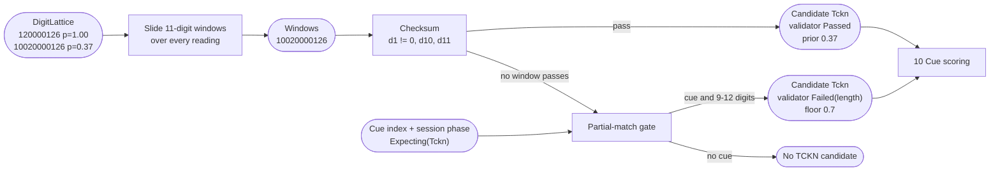
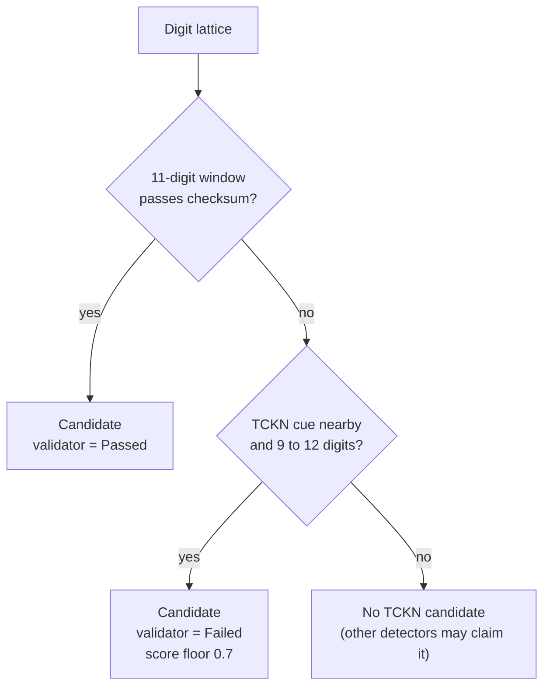

# 04. TCKN validation

## Purpose

Detect and validate the 11-digit Turkish national identity number (TCKN), including partially heard numbers that are still clearly PII.

## Where it runs

| | |
|---|---|
| Pipeline stage | Detect, Validate |
| Crate | `ortu-tr` |
| Modes | Realtime and PostCall |
| Channels | Speech and Text |

## Inputs and outputs

- Input: digit lattices from [03](03-spoken-number-lattice.md), the cue index, session state.
- Output: `Candidate { kind: Tckn, span, validator, cues, ... }`.

## Data flow



| From | Data | To |
|---|---|---|
| 03 | `DigitLattice` | window slider |
| 10 (cue index), 12 (session phase) | Cue hits, `Expecting(Tckn)` | partial-match gate |
| This step | `Candidate { kind: Tckn, validator, prior, digit-to-word map }` | 10 Cue scoring |

## Algorithm

### Checksum

With digits `d1 ... d11`:

```
valid(d):
    len(d) == 11
    d1 != 0
    d10 == ((d1 + d3 + d5 + d7 + d9) * 7 - (d2 + d4 + d6 + d8)).rem_euclid(10)
    d11 == (d1 + d2 + ... + d10) % 10
```

`rem_euclid` is required: the intermediate value can be negative, and Rust's `%` keeps the sign of the dividend.

### Detection over the lattice

```
detect_tckn(lattice, cues):
    for reading in lattice.readings:
        for each 11-digit window w in reading.digits:
            if valid(w): emit Candidate(w, validator = Passed, prior = reading.prior)
    if no Passed candidate and has_cue(Tckn, cues, window):
        for reading in lattice.readings:
            if 9 <= len(reading.digits) <= 12:
                emit Candidate(reading, validator = Failed(length or checksum),
                               policy_floor = 0.7)     # partial-match policy
                break                                   # best prior only
```



### Partial-match policy

When a cue (`TC`, `kimlik`, `T.C.`, `te ce`) is present and the run has 9 to 12 digits, the run is masked with a score floor of 0.7 even if the checksum fails. STT may have dropped or inserted a digit, but the caller clearly intended to disclose an identity number. The token is issued with a validity marker (`[TCKN_INCOMPLETE:...]` or `[TCKN_INVALID:...]`, see [13](13-keyed-tokenization.md)) so that an LLM can ask the caller to repeat it.

## Worked example

Synthetic number `10000000146`:

| Step | Computation | Result |
|---|---|---|
| Odd positions d1, d3, d5, d7, d9 | 1 + 0 + 0 + 0 + 1 | 2 |
| Even positions d2, d4, d6, d8 | 0 + 0 + 0 + 0 | 0 |
| d10 | (2 * 7 - 0) rem 10 | 4 (matches) |
| d11 | (1 + 0 + 0 + 0 + 0 + 0 + 0 + 0 + 1 + 4) % 10 | 6 (matches) |

Lattice oracle example (`yüz yirmi sıfır sıfır sıfır on iki altı`): see [03, worked example 2](03-spoken-number-lattice.md#worked-example-2-the-checksum-as-an-oracle). The 9-digit natural reading fails; the 11-digit reading `10020000126` passes and wins.

## Complexity

O(L * R) per run, where L is the reading length and R <= 8 readings. Each checksum is O(1).

## Edge cases

- **Longer runs:** an IBAN or a card number may contain an 11-digit window that happens to pass. Conflict resolution ([11](11-conflict-resolution.md)) prefers the more specific kind (IBAN, card) over TCKN.
- **Foreign resident numbers** (starting with 99) pass the same checksum and are treated as TCKN.
- **Cue in the previous agent turn:** handled by session state ([12](12-cross-turn-assembly.md)), which marks the next caller turn as cue-bearing.
- **No cue, checksum fails:** not a TCKN candidate; the run is still available to other detectors.

## Design rationale

- **Floor score for partial matches instead of exact-only:** exact-only validation would leak every TCKN that STT damaged, and STT damages long digit strings often. The floor is gated by a cue to keep false positives bounded.
- **Validity markers on the token:** an LLM cannot count the digits behind a token. Without the marker, a voice agent would confidently submit a 10-digit "TCKN" to a backend.

## Tests and invariants

- Known valid and invalid vectors, including negative intermediate values in the d10 formula.
- Proptest: every generated valid TCKN is detected under every reading style.
- Proptest: changing any single digit of a valid TCKN makes the checksum fail.
- At least 20 positive and 20 negative unit tests (milestone M2).
