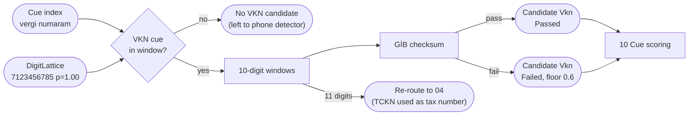

# 05. VKN validation

## Purpose

Detect and validate the 10-digit Turkish tax identification number (VKN) issued by the Revenue Administration (GİB).

## Where it runs

| | |
|---|---|
| Pipeline stage | Detect, Validate |
| Crate | `ortu-tr` |
| Modes | Realtime and PostCall |
| Channels | Speech and Text |

## Inputs and outputs

- Input: digit lattices ([03](03-spoken-number-lattice.md)), cue index.
- Output: `Candidate { kind: Vkn, ... }`.

## Data flow



| From | Data | To |
|---|---|---|
| 03 | `DigitLattice` | cue gate, window slider |
| 10 | VKN cue hits | cue gate (required) |
| This step | `Candidate { kind: Vkn }` | 10 Cue scoring |
| This step | 11-digit readings after a VKN cue | 04 TCKN validation |

## Algorithm

> **Verification required.** The formula below is the commonly published form of the GİB algorithm. Before M4 is accepted, the implementation must be checked against known valid and invalid vectors from an official or authoritative source, and that source must be cited in an ADR.

With 0-based digits `d[0] ... d[9]`:

```
valid(d):
    len(d) == 10
    sum = 0
    for i in 0..9:
        t = (d[i] + 10 - (i + 1)) % 10
        v = (t * 2^(10 - (i + 1))) % 9
        if t != 0 and v == 0: v = 9
        sum += v
    return d[9] == (10 - sum % 10) % 10
```

Detection:

```
detect_vkn(lattice, cues):
    require has_cue(Vkn, cues, window)          # vergi, vergi no, vergi numarası, VKN
    for reading in lattice.readings:
        for each 10-digit window w:
            if valid(w): emit Candidate(w, validator = Passed)
    if none passed and a 10-digit reading exists:
        emit Candidate(best, validator = Failed(checksum), policy_floor = 0.6)
```

A cue is **required**. A bare 10-digit string is far more likely to be a phone number, and the VKN checksum alone accepts roughly one in ten random strings, which is too weak to stand on its own.

## Worked example (illustrative, pending verification)

Synthetic number `7123456785`, first nine digits `7 1 2 3 4 5 6 7 8`:

| i | d[i] | t = (d + 10 - (i+1)) % 10 | 2^(9-i) % 9 | v = t * 2^(9-i) % 9 | adjusted v |
|---|---|---|---|---|---|
| 0 | 7 | 6 | 8 | 3 | 3 |
| 1 | 1 | 9 | 4 | 0 | 9 |
| 2 | 2 | 9 | 2 | 0 | 9 |
| 3 | 3 | 9 | 1 | 0 | 9 |
| 4 | 4 | 9 | 5 | 0 | 9 |
| 5 | 5 | 9 | 7 | 0 | 9 |
| 6 | 6 | 9 | 8 | 0 | 9 |
| 7 | 7 | 9 | 4 | 0 | 9 |
| 8 | 8 | 9 | 2 | 0 | 9 |

`sum = 75`, check digit `(10 - 5) % 10 = 5`, which matches `d[9] = 5`.

Compute `2^k % 9` by repeated multiplication modulo 9; never materialize `2^9` in a narrow integer type.

## Complexity

O(L * R) per run; O(1) per checksum.

## Edge cases

- **10-digit phone numbers:** without a VKN cue the run is left to the phone detector. With both cues present, conflict resolution decides ([11](11-conflict-resolution.md)).
- **TCKN given as a tax number:** individuals often use their TCKN as a tax number. An 11-digit value after a VKN cue is validated as a TCKN and labeled `Tckn`.

## Design rationale

- **Cue required:** the checksum's false-acceptance rate is too high for unsupervised detection, and the phone space overlaps the VKN space.
- **Verification as an explicit gate:** a wrong checksum silently degrades recall for an entire entity type. Making verification an acceptance criterion forces the evidence into the repository.

## Tests and invariants

- Official vectors (once sourced), both valid and invalid.
- Proptest: single-digit mutations of a valid VKN are rejected at a rate consistent with the checksum's strength (measured and documented, not assumed).
