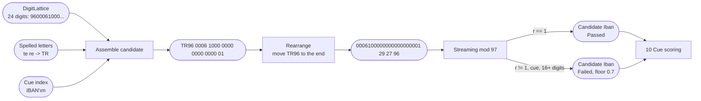
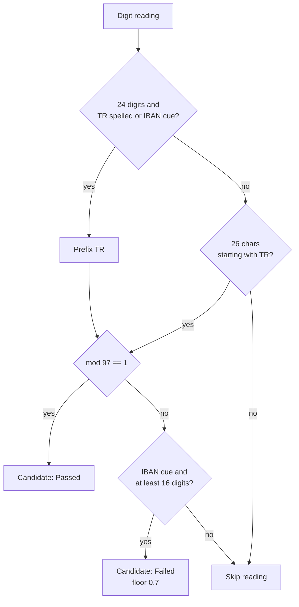

# 06. IBAN validation

## Purpose

Detect and validate Turkish IBANs, including the common spoken form in which the caller omits the `TR` prefix and reads only the digits.

## Where it runs

| | |
|---|---|
| Pipeline stage | Detect, Validate |
| Crate | `ortu-tr` |
| Modes | Realtime and PostCall |
| Channels | Speech and Text |

## Structure of a TR IBAN

```
T R 9 6 | 0 0 0 6 1 | 0 | 0 0 0 0 0 0 0 0 0 0 0 0 0 0 0 1
country   check       bank code   reserved   account number (16)
          digits (2)  (5)         (1)
```

26 characters in total.

## Data flow



| From | Data | To |
|---|---|---|
| 03 | `DigitLattice` | candidate assembly |
| Spelling normalizer | `TR` from `te re` / `t r` | candidate assembly |
| 10 | IBAN cue hits | prefix assumption, partial-match gate |
| This step | `Candidate { kind: Iban }` | 10 Cue scoring; 11 ranks it above TCKN/phone windows inside it |

## Algorithm

### ISO 13616 mod-97 check

```
valid(iban):                                  # uppercase, no spaces
    len(iban) == 26 and iban starts with "TR"
    rearranged = iban[4..] + iban[0..4]       # move "TR96" to the end
    r = 0
    for ch in rearranged:
        if ch is a digit: r = (r * 10 + digit(ch)) % 97
        else:             r = (r * 100 + (ch - 'A' + 10)) % 97   # T = 29, R = 27
    return r == 1
```

The remainder is computed digit by digit, so no big-integer type is needed and the loop never overflows a `u32`.

### Detection

```
detect_iban(lattice, letters, cues):
    for reading in lattice.readings:
        if spelled "TR" precedes the run and len(reading) == 24:
            candidate = "TR" + reading
        elif has_cue(Iban, cues) and len(reading) == 24:
            candidate = "TR" + reading               # prefix assumed
        elif len(reading) == 26 and text form starts with TR:
            candidate = reading
        else: continue
        if valid(candidate): emit Candidate(candidate, Passed)
    if none passed and has_cue(Iban, cues) and longest reading >= 16 digits:
        emit Candidate(best, Failed(checksum), policy_floor = 0.7)
```

Spelled-out `te re` / `t r` is resolved to `TR` by the spelling normalizer (design document §6.5).



## Worked example

Synthetic IBAN `TR96 0006 1000 0000 0000 0000 01`.

The BBAN `0006100000000000000001` is followed by `TR96`, with `T = 29` and `R = 27`, giving the numeric string `0006100000000000000001` `29` `27` `96`.

| Segment processed | Remainder after segment |
|---|---|
| `000610` | 28 |
| fifteen `0` digits | 96 |
| `1` | 88 |
| `29` (T) | 2 |
| `27` (R) | 33 |
| `9` | 48 |
| `6` | 1 |

Final remainder `1`: valid.

Computing the check digits for a new synthetic IBAN uses the same loop on `BBAN + "TR00"`, then `check = 98 - r`.

## Complexity

O(26) per candidate; at most R = 8 readings per run.

## Edge cases

- **Check digits attached to the prefix** (`TR33 0006 ...`): the prefix word contributes its digits, and a body window of the remaining length completes it.

- **Partial reads:** callers often stop after the first few groups and continue later; cross-turn assembly ([12](12-cross-turn-assembly.md)) joins the pieces.
- **Overlapping TCKN windows:** a 24-digit IBAN body can contain an 11-digit window that passes the TCKN checksum. IBAN wins on specificity ([11](11-conflict-resolution.md)).
- **Spaces and groups in text:** the Text channel removes spaces and normalizes case before validation; the span covers the original spacing.

## Design rationale

- **Assume `TR` with a cue:** in speech the prefix is usually omitted. Requiring it would miss most spoken IBANs.
- **Streaming remainder instead of big integers:** simpler, allocation-free and constant-time per character.

## Tests and invariants

- The SWIFT IBAN registry example (`TR33 0006 1005 1978 6457 8413 26`) and 20 IBANs generated independently in Python (real bank codes, computed check digits) validate, written with `TR33` attached, after `te re`, after a bare `TR` or after a cue (`crates/ortu-tr/tests/kinds.rs`).
- A wrong check digit after a cue is masked as `_INVALID`; a body without `TR` and without a cue is not claimed.
- Fuzz target `iban_validate` and the analyzer stress test cover arbitrary input.
- Any single-character substitution or adjacent transposition fails (a known property of mod-97).
- Spoken readings with and without `te re` produce the same candidate.
