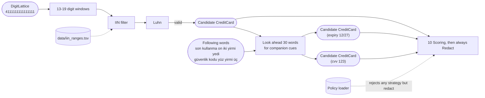
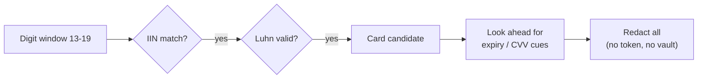

# 07. Luhn and card detection

## Purpose

Detect payment card numbers and their associated secrets (CVV, expiry date), and **always redact** them.

## Where it runs

| | |
|---|---|
| Pipeline stage | Detect, Validate |
| Crate | `ortu-tr` |
| Modes | Realtime and PostCall |
| Channels | Speech and Text |

## Data flow



| From | Data | To |
|---|---|---|
| 03 | `DigitLattice` | window slider |
| `data/iin_ranges.tsv` | Issuer prefixes and lengths | IIN filter |
| Following words in the same call | Expiry and CVV expressions | companion detector |
| This step | Card, expiry and CVV candidates | 10 Cue scoring; transform is fixed to `Redact` |

## Algorithm

### Luhn checksum

```
luhn_valid(d):                               # 13 to 19 digits
    sum = 0
    for i, digit in enumerate(reverse(d)):
        if i is odd:
            x = digit * 2
            if x > 9: x -= 9
            sum += x
        else:
            sum += digit
    return sum % 10 == 0
```

### IIN (issuer) ranges

| Network | Prefix | Lengths |
|---|---|---|
| Visa | 4 | 13, 16, 19 |
| Mastercard | 51-55, 2221-2720 | 16 |
| American Express | 34, 37 | 15 |
| Troy | 9792 | 16 |

The table is data (`data/iin_ranges.tsv`), not code, so it can be updated without a release of the detection logic.

### Detection and companion secrets

```
detect_card(lattice, cues):
    for reading in lattice.readings:
        for each window w with len in 13..=19:
            if iin_match(w) and luhn_valid(w):
                emit Candidate(w, kind = CreditCard, Passed)
    for each card candidate c:
        look ahead up to 30 words for companion cues:
            "son kullanma", "skt"        -> next date expression  -> CreditCard (expiry)
            "güvenlik kodu", "cvv",
            "arkasındaki üç hane"        -> next 3 or 4 digits    -> CreditCard (cvv)
```

Companion secrets are tagged `CreditCard` so they inherit the same strategy.

### Strategy

The transform is always `Redact` (decision D13). The policy loader **rejects** any configuration that sets another strategy for `credit_card`.



## Worked example

Standard test number `4111 1111 1111 1111` (Visa test range):

| Position from right | Digit | Doubled? | Contribution |
|---|---|---|---|
| 1 | 1 | no | 1 |
| 2 | 1 | yes | 2 |
| ... | ... | ... | ... |
| 15 | 1 | no | 1 |
| 16 | 4 | yes | 8 |

Eight undoubled ones = 8; seven doubled ones = 14; doubled leading 4 = 8. Total `30`, divisible by 10: valid.

## Complexity

O(L) per window; windows bounded by run length and the 13-19 range.

## Edge cases

- **IBAN bodies and long reference numbers** can contain Luhn-valid windows. The IIN filter removes most of them; conflict resolution ranks IBAN above card.
- **CVV without a card in the same call segment:** a CVV cue alone with 3-4 digits is still redacted (recall-first), labeled `CreditCard`.

## Design rationale

- **Always redact:** tokenizing or encrypting card data pulls the deployment into PCI-DSS scope. Making it impossible to configure otherwise protects every adopter from an accidental compliance failure.
- **IIN filter before Luhn:** Luhn accepts one in ten random strings; the IIN filter makes the combination specific enough for long digit runs.

## Tests and invariants

- Network test numbers for every IIN range.
- The policy loader rejects `transform != "redact"` for cards.
- After redaction, no card digits, expiry or CVV values appear in the output (substring proptest).
