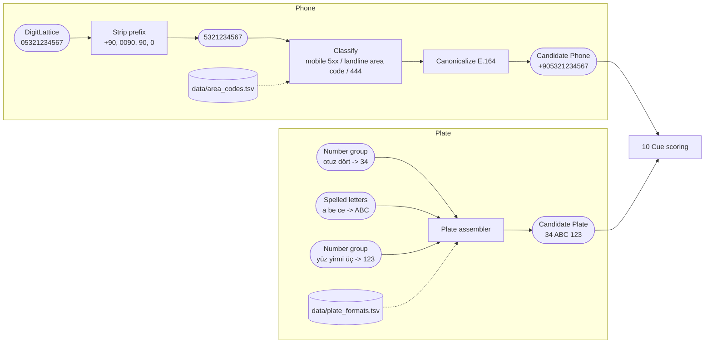
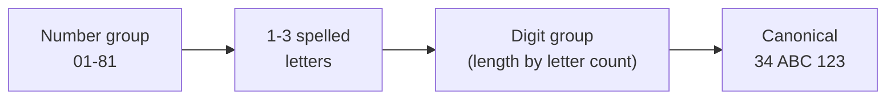

# 08. Phone and plate detection

## Purpose

Detect Turkish phone numbers (mobile and landline) and vehicle license plates, and canonicalize them so that the same value always produces the same token.

## Where it runs

| | |
|---|---|
| Pipeline stage | Detect, Validate |
| Crate | `ortu-tr` |
| Modes | Realtime and PostCall |
| Channels | Speech and Text |

## Data flow



| From | Data | To |
|---|---|---|
| 03 | `DigitLattice`, number groups | prefix stripper, plate assembler |
| Spelling normalizer | Letters | plate assembler |
| `data/area_codes.tsv`, `data/plate_formats.tsv` | Valid area codes and plate shapes | classifiers |
| This step | Canonical phone (E.164) and plate | 10 Cue scoring; 13 uses the canonical form for tokens |

## Phone numbers

### Algorithm

```
detect_phone(lattice, cues):
    for reading in lattice.readings:
        n = strip_prefix(reading)        # +90, 0090, 90, 0 -> national number
        if len(n) != 10: continue
        if n starts with "444": continue            # corporate numbers, not PII (configurable)
        if n[0] == '5':                    kind_detail = Mobile
        elif area_code(n[0..3]) in AREA_CODES: kind_detail = Landline
        else: continue
        emit Candidate(canonical = "+90" + n, Passed)

strip_prefix(r):
    longest match of ["0090", "+90", "90", "0"] at the start, only if the
    remainder has exactly 10 digits
```

`AREA_CODES` is loaded from `data/area_codes.tsv`.

### Canonical form

E.164: `+90` followed by the 10-digit national number. `0532 123 45 67`, `90 532 1234567` and `beş yüz otuz iki ...` all canonicalize to `+905321234567` and therefore share one token.

## License plates

### Pattern

```
province   (0[1-9] | [1-7][0-9] | 8[01])        01 to 81
letters    1 to 3 letters from the plate alphabet
digits     count depends on the letter count (see table)
```

| Letters | Digits (initial table) |
|---|---|
| 1 | 4 |
| 2 | 3 or 4 |
| 3 | 2 or 3 |

> **Verification required.** The letter/digit table is stored as data (`data/plate_formats.tsv`) and must be checked against the current Highway Traffic Regulation before M4 is accepted. The source is cited in an ADR.

### Spoken plates

```
"otuz dört a be ce yüz yirmi üç"
 province = 34   letters = A B C (spelled)   digits = 123   ->  34 ABC 123
```

Spelled letters are resolved by the spelling normalizer (design document §6.5); the province and digit parts come from the number lattice.



## Complexity

O(L * R) per run for phones; O(words) per candidate for plates.

## Edge cases

- **Phone vs. VKN vs. TCKN:** a 10-digit run starting with 5 is ambiguous between a mobile number and a VKN. Without a VKN cue, phone wins; see [11](11-conflict-resolution.md).
- **Partial phone numbers:** `0532 123` followed by a pause and the rest in the next turn is joined by cross-turn assembly ([12](12-cross-turn-assembly.md)).
- **Plates in addresses or prices:** without a plate cue (`plaka`, `araç`, `aracım`), a plate pattern needs a strong letter group (two or more spelled letters) to be emitted.

## Design rationale

- **Canonicalization before tokenization:** without it, the same phone number read in two styles would produce two tokens, breaking rehydration and analytics linking.
- **444 numbers excluded by default:** they identify organizations, not people, and masking them makes transcripts harder to use without a privacy benefit.
- **Formats as data:** plate and area-code rules change rarely but do change; data files can be updated and reviewed without touching detection code.

## Tests and invariants

- Every prefix style canonicalizes to the same E.164 value.
- Every province code 01-81 with every valid letter/digit combination from the table.
- Negative tests: 444 numbers, 10-digit runs with invalid area codes, plate patterns with province 00 or 82+.
