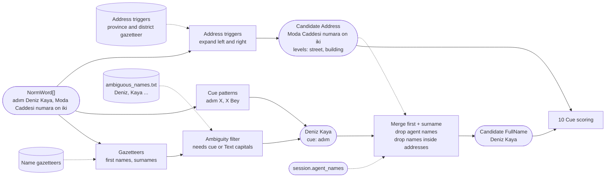
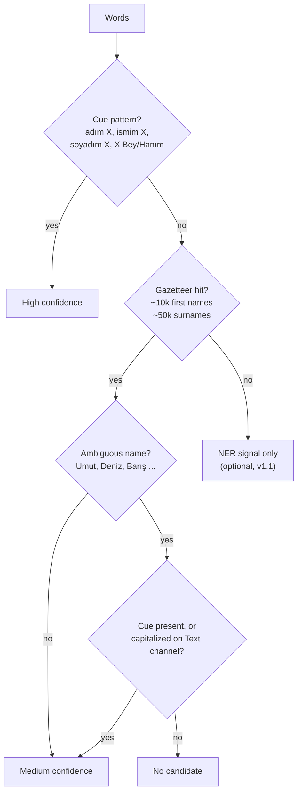

# 09. Name and address detection

## Purpose

Detect person names and addresses, which have no checksum and depend on context. Precision matters here more than for numeric entities, because many Turkish names are also common words.

## Where it runs

| | |
|---|---|
| Pipeline stage | Detect |
| Crate | `ortu-tr` (optional NER signal from `ortu-ner`) |
| Modes | Realtime and PostCall |
| Channels | Speech and Text |

## Data flow



| From | Data | To |
|---|---|---|
| 01 | `NormWord[]` (folded, match_key) | address expander, name matchers |
| Data files | Gazetteers, ambiguous names, address triggers | matchers and filters |
| Session | Agent names | exemption filter |
| This step | `Address` (with levels), `PersonName`, `PersonSurname`, `FullName` | 10 Cue scoring; 11 applies address granularity (`keep_levels`) |

## Person names

### Three layers



### Algorithm

```
detect_names(words, cues, session):
    # Layer 1: cue patterns
    for pattern in NAME_PATTERNS:                     # "adım {N}", "{N} bey", ...
        for m in match(pattern, words.match_key):
            emit Candidate(m.slot, PersonName or FullName, cue = pattern)

    # Layer 2: gazetteers (Aho-Corasick over folded forms)
    for hit in FIRST_NAMES.find_iter(words) + SURNAMES.find_iter(words):
        if hit in AMBIGUOUS_NAMES and not (cue_nearby(hit) or capitalized_text(hit)):
            continue
        emit Candidate(hit, PersonName or PersonSurname)

    # Adjacent first name + surname merge into FullName.
    merge_adjacent(PersonName, PersonSurname) -> FullName

    # Exemptions
    drop candidates matching session.agent_names    # the agent's own name
    drop candidates inside an Address span           # "Ahmet Yesevi Mahallesi"
```

## Addresses

### Algorithm

```
detect_addresses(words):
    for t in words where t.match_key in ADDRESS_TRIGGERS:    # mahallesi, sokak, cadde, no, daire ...
        start = expand_left(t)   # back over the noun phrase naming the street/neighborhood
        end   = expand_right(t)  # forward over "no", "daire", "kat", "blok" and their numbers
        span  = clip(start, end, max_words = 15)
        levels = classify(span)  # province, district, neighborhood, street, building, unit
        emit Candidate(span, Address, levels)

apply_granularity(candidate, policy.keep_levels):
    mask only the levels not in keep_levels          # default keep: province, district
```

### Worked example

```
"Kadıköy Caferağa Mahallesi Moda Caddesi numara on iki daire üç"
 district  neighborhood         street          building    unit
 kept      masked               masked          masked      masked
```

Output (Text rendering): `Kadıköy [ADDRESS:3c9d...]`

## Complexity

Aho-Corasick: O(n + matches) per turn. Address expansion: O(max_words) per trigger.

## Edge cases

- **Names inside institution or place names:** `Ahmet Yesevi Mahallesi`, `Atatürk Caddesi`. The address detector claims the span first; names inside an address span are dropped.
- **Agent self-introduction:** "Ben belediyenin dijital asistanıyım" or a human agent saying their own name. Exempted through `session.agent_names`.
- **Common-word names:** `Gül`, `Yıldız`, `Kaya` appear constantly as ordinary words. Without a cue they are never masked on the Speech channel.
- **STT casing:** speech transcripts often have unreliable capitalization; capitalization is used as a signal only on the Text channel.

## Design rationale

- **Cue-first, gazetteer second:** cues give high precision; gazetteers give recall. Requiring cues for ambiguous names keeps the false-positive rate tolerable without dropping recall for distinctive names.
- **Keeping province and district by default:** in municipal and service calls these are routing information. Masking them makes the transcript unusable while adding little privacy, because they identify large populations.
- **NER as a signal, not a decider:** the model's errors are hard to explain in an audit; as one weighted input it can only tip borderline cases.

## Tests and invariants

- The ambiguous-name list has tests for both the masked (with cue) and unmasked (without cue) case.
- Exemptions never remove a candidate that also matched a cue pattern addressed to the caller.
- Address granularity: for every `keep_levels` setting, only the expected levels are masked.
