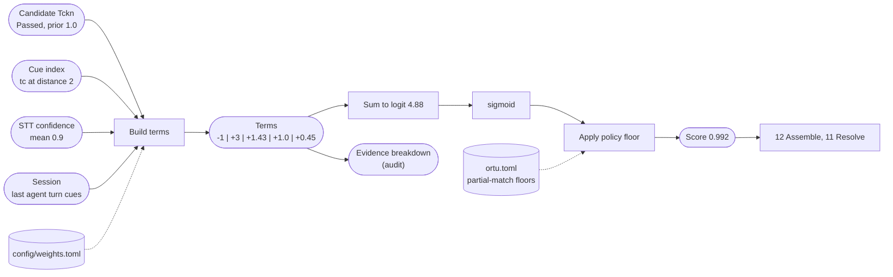
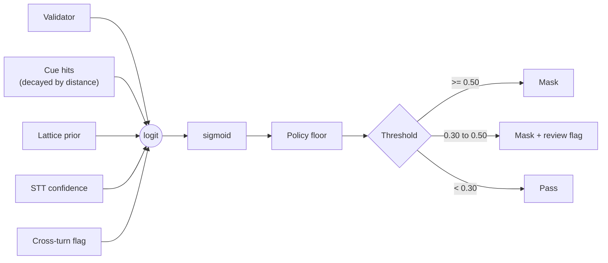

# 10. Cue scoring

## Purpose

Turn the evidence attached to a candidate (validator outcome, context cues, lattice prior, STT confidence, cross-turn assembly) into a single calibrated score in `[0, 1]` that the policy can threshold, and that an auditor can explain term by term.

## Where it runs

| | |
|---|---|
| Pipeline stage | Score context |
| Crate | `ortu-core` |
| Modes | Realtime and PostCall |

## Inputs and outputs

- Input: `Candidate` with `Evidence`; the cue index of the turn and of the session.
- Output: `Score` plus a per-term breakdown stored in `Evidence` (for audit).

## Data flow



| From | Data | To |
|---|---|---|
| 04-09 | Candidates with validator outcome and prior | term builder |
| 01 + cue rules | Cue hits with distances | term builder |
| STT via `push` | Word confidences | term builder |
| 12 (session) | Cues from the previous agent turn | term builder |
| `config/weights.toml`, `ortu.toml` | Weights, floors | term builder, floor |
| This step | `Score`, per-term breakdown in `Evidence` | 12, 11; audit trail |

## Cue matching

```rust
pub struct CueRule {
    pub kind: EntityKind,
    pub patterns: &'static [&'static str],  // normalized stems, e.g. "tc", "kimlik", "iban", "numara"
    pub window_before: u16,                 // words
    pub window_after: u16,
    pub boost: f32,
    pub cross_turn: bool,                   // may the cue sit in the previous agent turn?
}
```

```
cue_hits(candidate):
    for rule in rules[candidate.kind]:
        for occurrence of rule.patterns (match on flatten(stem); a trailing * matches a prefix):
            d = word distance from the occurrence to the candidate span
            if occurrence is inside [span.start - window_before, span.end + window_after]:
                yield CueHit { rule, distance: d }
            elif rule.cross_turn and occurrence is in session.last_agent_turn:
                yield CueHit { rule, distance: window_before }    # treated as at the window edge
```

## Score model

```
logit = w_detector
      + w_validator * [validator passed]
      - w_invalid   * [validator failed and length exact]
      + sum over cue hits:  w_cue(rule) * exp(-distance / tau)
      + w_prior     * lattice_prior
      + w_stt       * mean(stt_confidence over span)     # 0 when STT reports none
      + w_cross     * [assembled across turns]

score = sigmoid(logit)
score = max(score, policy_floor)         # partial-match policies (04, 05, 06)
```

Initial weights (hand-set; calibrated in M7 and stored in `config/weights.toml`):

| Weight | Initial value | Rationale |
|---|---|---|
| `w_detector` | -1.0 | A bare pattern match is not enough on its own |
| `w_validator` | 3.0 | A passed checksum is the strongest single signal |
| `w_invalid` | 2.0 | Right length, wrong checksum is evidence against |
| `w_cue` | 2.0 | Explicit context ("TC'm") |
| `w_prior` | 1.0 | Lattice preference |
| `w_stt` | 0.5 | STT confidence is noisy; small weight |
| `w_cross` | 0.5 | Assembly across turns is plausible but less certain |
| `tau` | 6 words | Cue influence halves roughly every 4 words |

## Worked examples

| Case | Terms | Logit | Score | Decision (mask >= 0.50, review >= 0.30) |
|---|---|---|---|---|
| Valid TCKN, cue 2 words away, prior 1.0, STT 0.9 | -1 + 3 + 2 * 0.717 + 1.0 + 0.45 | 4.88 | 0.992 | Mask |
| 11 digits, checksum fails, no cue, prior 0.6, STT 0.9 | -1 - 2 + 0.6 + 0.45 | -1.95 | 0.125 | Pass |
| 9 digits after a TCKN cue | sigmoid(...) then floor | n/a | 0.70 | Mask (`TCKN_INCOMPLETE`) |



## Calibration (M7)

1. Generate a labeled synthetic set (design document §14.1).
2. Fit weights by logistic regression on the evidence features, with a recall constraint per kind.
3. Report reliability (predicted score vs. observed precision per bucket) in `docs/calibration.md`.
4. Ship the fitted weights in `config/weights.toml`; the code never hard-codes them.

## Complexity

O(cue occurrences in window) per candidate; cue occurrences are precomputed per turn.

## Design rationale

- **Logistic model instead of a classifier:** every term is a named, inspectable quantity, which the audit trail can show ("masked because: checksum passed, cue 'TC' two words before"). A gradient-boosted model would score better on paper and be unexplainable in a dispute.
- **Exponential decay instead of a hard window:** a hard window creates cliffs where moving a word by one position flips the decision.
- **Floors as policy, not weights:** partial-match rules are business rules ("a cue plus nine digits is always masked"). Keeping them outside the learned weights makes them stable across recalibration.

## Tests and invariants

- Monotonicity: adding a cue hit or a passed validator never lowers the score.
- The per-term breakdown in `Evidence` sums to the logit.
- Calibration report is regenerated by `cargo xtask eval` and reviewed as a diff in the same commit as any weight change.
