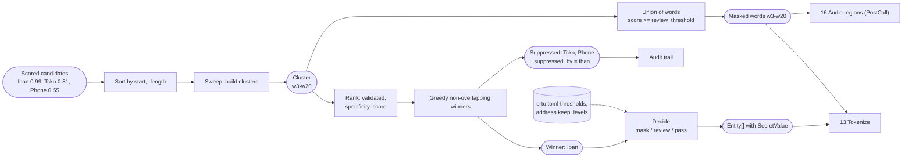
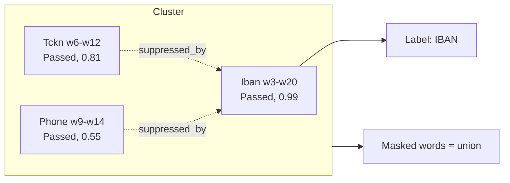

# 11. Conflict resolution

## Purpose

Several detectors often claim overlapping words: a 24-digit IBAN body contains windows that look like a TCKN or a phone number. This step picks a **label** for each region while guaranteeing that the **masked region** never shrinks because of that choice.

## Where it runs

| | |
|---|---|
| Pipeline stage | Resolve, Decide |
| Crate | `ortu-core` |
| Modes | Realtime and PostCall |

## Inputs and outputs

- Input: scored candidates of one turn (or of the whole call in PostCall).
- Output: `Entity` list (winners), the set of masked words, and `suppressed_by` records for the audit trail.

## Data flow



| From | Data | To |
|---|---|---|
| 10 / 12 | Scored candidates (per turn or per call) | sorter |
| `ortu.toml` | Thresholds, address granularity | decision step |
| This step | `Entity[]` (winners), masked word set | 13 Tokenize, 16 Audio |
| This step | Suppressed candidates | audit trail |

## Algorithm

```
resolve(candidates):
    sort candidates by (span.start, -span.len)

    # 1. Build clusters of transitively overlapping candidates (sweep line).
    clusters = []
    current = []; current_end = -inf
    for c in candidates:
        if c.start < current_end: current.push(c); current_end = max(current_end, c.end)
        else: clusters.push(current); current = [c]; current_end = c.end
    clusters.push(current)

    for cluster in clusters:
        # 2. Choose labels greedily by rank, without overlap.
        ranked = sort cluster by rank(c) descending
        winners = []
        for c in ranked:
            if c.score >= review_threshold and no winner overlaps c:
                winners.push(c)
            else if a winner w overlaps c:
                audit(c.suppressed_by = w.id)

        # 3. Mask union: every qualifying candidate contributes its words.
        masked_words |= union(words(c) for c in cluster if c.score >= review_threshold)

rank(c) = ( c.validator == Passed,
            specificity(c.kind),        # Iban > CreditCard > Tckn > Vkn > Phone > Plate > generic
            c.score,
            len(c.words),               # ties: the longer span,
            -c.words.start )            # then the earlier start: order-independent
```

## Worked example

```
"IBAN'ım TR otuz üç sıfır sıfır altı bir ..." (a full 24-digit body)
```

| Candidate | Words | Validator | Score | Outcome |
|---|---|---|---|---|
| Iban | w3..w20 | Passed | 0.99 | **Winner** (label) |
| Tckn | w6..w12 | Passed (coincidental window) | 0.81 | Suppressed by Iban |
| Phone | w9..w14 | Passed | 0.55 | Suppressed by Iban |

Masked words: the union `w3..w20` (the Tckn and Phone spans are inside it). The output contains one token, `[IBAN:...]`.



## Why the mask is a union

Suppose a weak candidate extends one word beyond the winner (for example a phone candidate that also covers a trailing digit the IBAN reading did not include). Masking only the winner would leave that digit visible. The union rule makes the label decision irrelevant to privacy: **choosing the wrong label can never cause a leak**.

## Complexity

Sorting O(n log n); cluster sweep O(n); greedy selection O(k^2) per cluster with k typically below 5.

## Edge cases

- **Two genuine entities touching:** a phone number immediately followed by a TCKN forms one cluster but two non-overlapping winners; both are labeled.
- **No candidate above threshold:** nothing is masked; candidates between review and mask thresholds are masked with a review flag by the Decide step.
- **Cross-turn entities:** in PostCall, spans can cross turns; the sweep works on global word positions.

## Design rationale

- **Separate labeling from masking:** labeling optimizes readability and analytics; masking optimizes privacy. Coupling them would make every labeling bug a potential leak.
- **Specificity order:** longer, structurally richer identifiers (IBAN, card) contain shorter ones by accident far more often than the reverse.
- **Suppressed candidates are kept in the audit trail:** reviewers can see what else the engine considered, which is essential when tuning weights.

## Tests and invariants

- Proptest: the masked word set is a superset of every qualifying candidate's words.
- Proptest: the result does not depend on input order (shuffled inputs, tied scores).
- Proptest: every qualifying candidate is either a winner or recorded as suppressed.
- Qualification uses `review_threshold`: candidates masked for review are masked too (`crates/ortu-core/tests/resolve_properties.rs`, 5,000 cases each).
- Winners never overlap each other.
