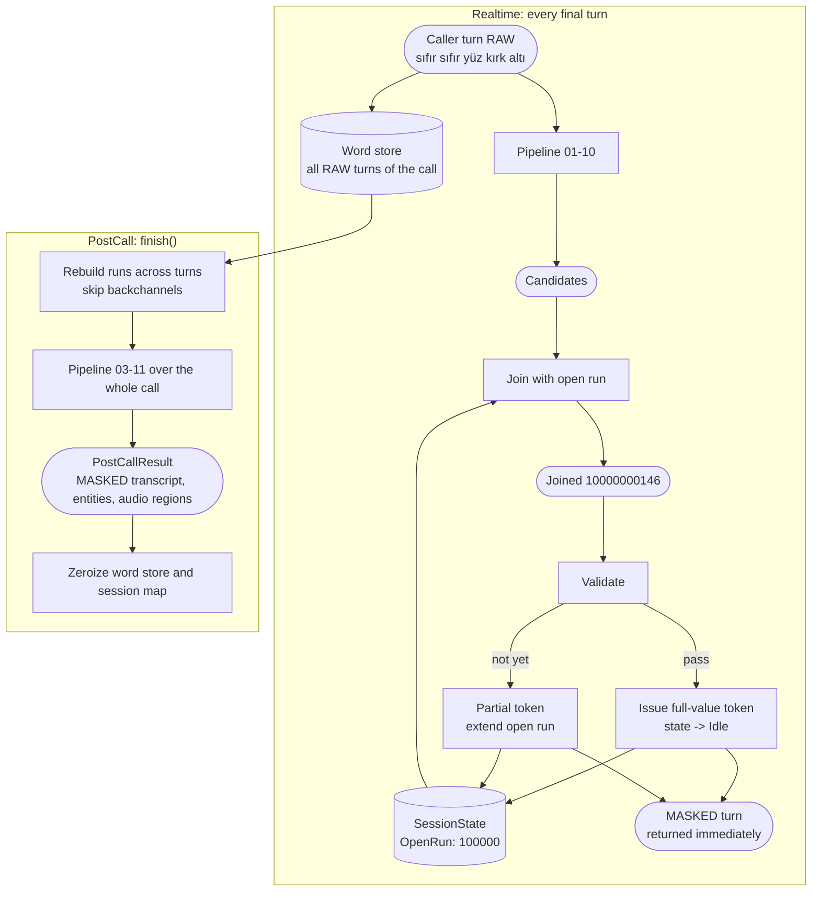
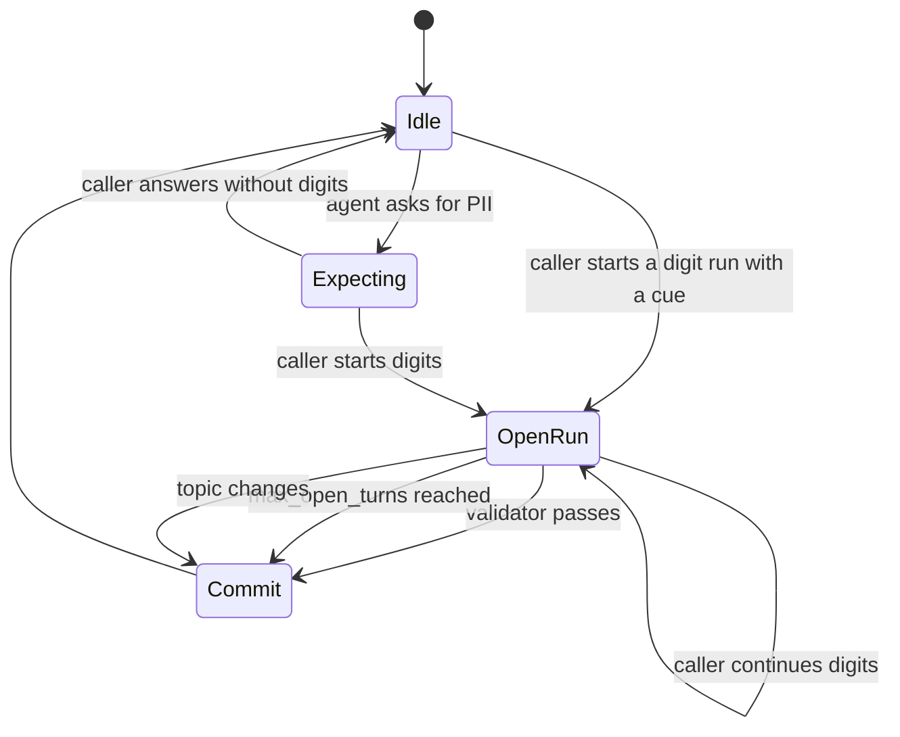

# 12. Cross-turn assembly

## Purpose

Join PII that is split across turns ("TC'm on iki üç yüz..." / agent: "evet" / "...kırk beş altmış yedi"), and do it in two ways: **eagerly** in Realtime mode, where no turn may be held back, and **exactly** in PostCall mode, where the whole call is available.

## Where it runs

| | |
|---|---|
| Pipeline stage | Assemble |
| Crate | `ortu-stream` |
| Modes | Realtime (eager) and PostCall (exact) |

## Data flow



| From | Data | To |
|---|---|---|
| Adopter `push` | Final turns (RAW) | Realtime pipeline; session word store |
| This step (Realtime) | Session state (phase, open run, last agent cues) | next `push` |
| This step (Realtime) | Masked turn, `(token, value)` pairs | adopter (to LLM); session map (15) |
| Session word store | All RAW turns | PostCall pass |
| This step (PostCall) | `PostCallResult` | adopter (to persistent stores); 16 Audio |

## Session state

```rust
struct SessionState {
    phase: Phase,                         // Idle | Expecting(kind) | OpenRun(OpenRun)
    last_agent_turn: Option<TurnCues>,    // PII question asked by the agent/bot
    open_turns: u8,                       // turns since the run opened
}

struct OpenRun {
    kind_hint: Option<EntityKind>,        // from the cue that opened it
    digits: SmallString<[u8; 32]>,
    sources: Vec<WordRef>,                // across turns
    partial_token: Option<Token>,         // issued in Realtime for the partial value
}
```

## State machine



## Realtime algorithm (eager)

```
push_realtime(turn):
    cues = detect_cues(turn)
    if turn.speaker is Agent/Bot:
        state.last_agent_turn = cues
        if cues ask for PII: state.phase = Expecting(kind)
        return mask(turn)                                    # agent turns are masked too

    runs = digit_runs(turn)
    if state.phase is OpenRun and runs.first starts at the turn start:
        joined = state.open.digits + runs.first.digits       # continuation
        if validates(joined, state.open.kind_hint):
            token = issue_token(joined)                       # full value
            emit turn with runs.first replaced by token
            state.phase = Idle
        else:
            extend state.open; state.open_turns += 1
            emit turn with runs.first masked as partial      # [TCKN_INCOMPLETE:...]
    else:
        handle runs as new candidates (Expecting boosts cue scores)

    if state.open_turns >= max_open_turns or topic_changed(turn):
        state.phase = Idle
    return masked turn immediately                            # never held
```

**Key property:** every turn is returned in the same call that received it. When a value completes in a later turn, the **completing turn** carries the token of the full value; earlier turns keep their partial tokens. The LLM uses the full-value token for tool calls.

## PostCall algorithm (exact)

```
finish():
    words = all caller words of the call, with global positions
    lattices = build over runs, where runs may cross turn boundaries
               if the gap between them is only agent backchannel ("evet", "hı hı", "tamam")
               or fillers, and at most max_open_turns turns apart
    candidates = detect + score over lattices (cross_turn = true where applicable)
    resolve and transform as usual
    return PostCallResult { transcript, entities, audio_regions }
```

PostCall reprocesses everything from the session's in-memory word store; it does not reuse Realtime decisions.

## Worked example

| Turn | Speaker | Text | Realtime output | Session phase after |
|---|---|---|---|---|
| 1 | Bot | TC kimlik numaranızı alabilir miyim? | unchanged | Expecting(Tckn) |
| 2 | Caller | on sıfır sıfır sıfır sıfır | `[TCKN_INCOMPLETE:a1...]` | OpenRun (6 digits: `100000`) |
| 3 | Bot | evet | unchanged | OpenRun |
| 4 | Caller | sıfır sıfır yüz kırk altı | `[TCKN:7f...]` (full value `10000000146`) | Idle |

PostCall output for the same call contains one `Tckn` entity spanning turns 2 and 4, with `cross_turn = true`.

## Complexity

Realtime: O(words in turn) plus O(1) state update. PostCall: the full pipeline over the call, once.

## Edge cases

- **Bot speaks between fragments:** backchannels are skipped for assembly; substantive bot turns (a new question) close the run.
- **Caller corrects across turns:** handled by correction markers ([02](02-filler-and-correction-marking.md)) on the joined sequence.
- **Two different entities in a row:** if the joined sequence over-runs the expected length, the validator splits it: the first valid window is committed and the remainder opens a new run.
- **Partial STT results:** never pushed; only final turns are processed.

## Design rationale

- **No hold-back:** see decision D7. A held turn is audible latency; eager partial masking keeps recall without waiting.
- **Two passes instead of one adaptive pass:** the Realtime pass optimizes latency and recall; the PostCall pass optimizes accuracy for what gets stored. Trying to do both in one pass leads to either latency or wrong persisted data.
- **PostCall does not trust Realtime decisions:** it has strictly more information; reusing early decisions would carry over their false positives.

## Tests and invariants

- `push` never returns `Held`; the API has no such variant.
- A TCKN split across 2 and 3 turns is detected in both modes.
- No raw digit of a split value appears in any Realtime output turn.
- PostCall output equals batch `redact()` over the same transcript.
