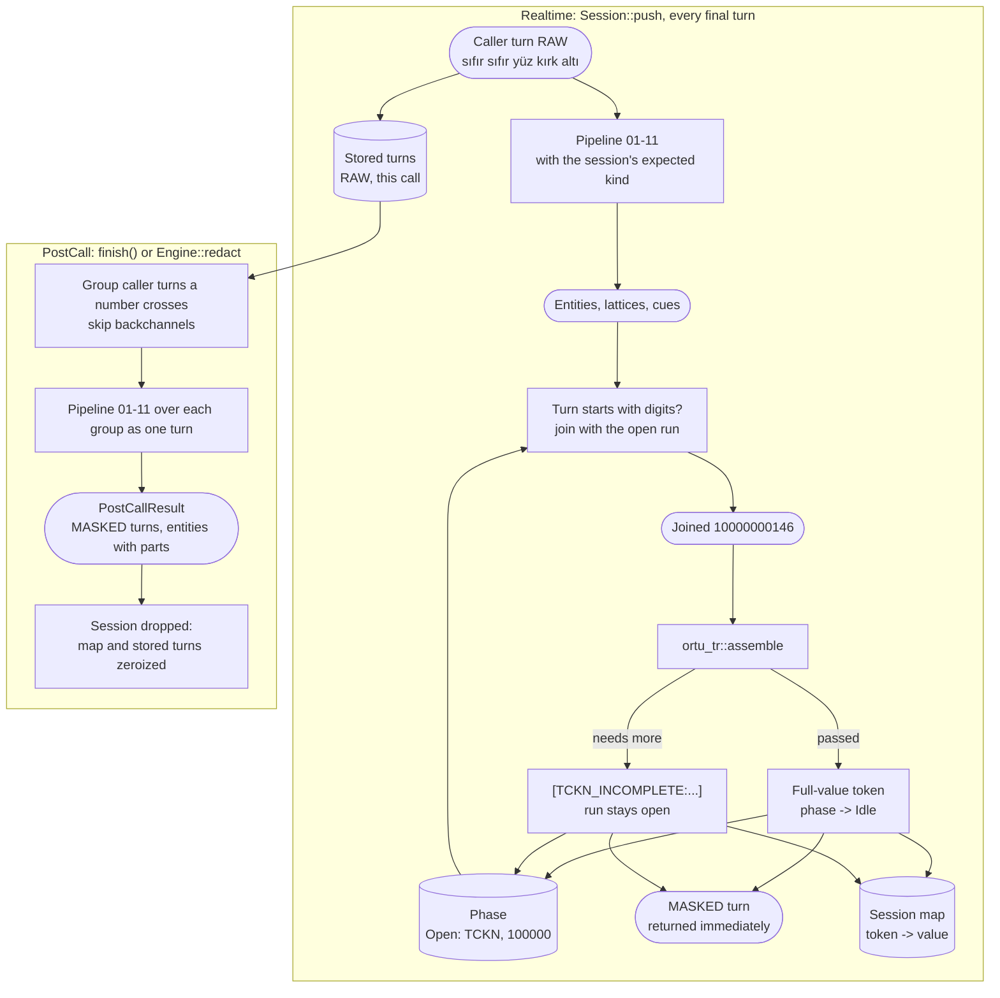
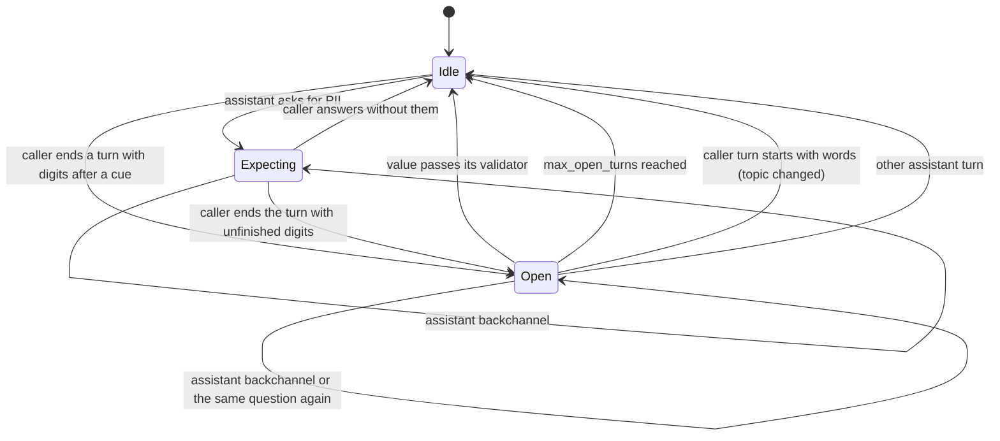

# 12. Cross-turn assembly

## Purpose

Join PII that is split across turns ("TC'm on iki üç yüz..." / agent: "evet" / "...kırk beş altmış yedi"), and do it in two ways: **eagerly** in Realtime mode, where no turn may be held back, and **exactly** in PostCall mode, where the whole call is available.

## Where it runs

| | |
|---|---|
| Pipeline stage | Assemble |
| Crate | `ortu-stream` (`session.rs` for Realtime, `postcall.rs` for PostCall); `ortu_tr::assemble` validates joined digits |
| Modes | Realtime (eager, `Session::push`) and PostCall (exact, `Session::finish` and `Engine::redact`) |

## Data flow



| From | Data | To |
|---|---|---|
| Adopter `push` | Final turns (RAW) | Realtime pipeline; stored turns |
| This step (Realtime) | Phase (idle, expecting a kind, open run) | next `push` |
| This step (Realtime) | Masked turn and entity reports; `(token, value)` pairs | adopter (to LLM); session map (15) |
| Stored turns | All RAW turns | PostCall pass |
| This step (PostCall) | `PostCallResult` | adopter (to persistent stores); 16 Audio |

## Session state

```rust
enum Phase {
    Idle,
    Expecting(EntityKind),        // the assistant asked for this kind
    Open(OpenRun),                // the caller started a value
}

struct OpenRun {
    kind: EntityKind,             // TCKN, IBAN or phone
    digits: Zeroizing<String>,    // digits so far, across turns
    parts: Vec<WordSpan>,         // (turn, words) of every fragment
    turns: u8,                    // caller turns the run spans
}
```

## State machine



## Realtime algorithm (eager)

```
push(turn):
    if turn.speaker is Agent or Bot:
        analysis = analyze(turn)
        if not backchannel(turn)                   # "evet", "hı hı", "devam edin"
           and not (phase is Open(run) and analysis asked for run.kind):
            phase = Expecting(kind) if analysis asked for a kind else Idle
        return mask(turn, analysis)               # assistant turns are masked too

    expected = phase.kind                          # from Expecting or Open
    analysis = analyze(turn, expected)             # the expected kind acts as a cue
    if phase is Open(run) and turn.leading_lattice exists:      # first content word starts a number
        for reading in lattice.readings:           # prefer the reading that completes the value
            joined = run.digits + reading.digits
            assembled = ortu_tr::assemble(run.kind, joined)
        replace the analysis entities on those words with the assembled entity
        if assembled.needs_more and run.turns + 1 < max_open_turns: keep the run open
        else: phase = Idle
    for every other lattice of the turn:           # unfinished values
        kind = expected (TCKN, IBAN or phone), else the most specific kind with a cue
        if kind and at least 2 digits and assemble(kind, best.digits).needs_more
           and no validated entity covers the digits:
            mask the digits as [KIND_INCOMPLETE:...]
            if the lattice ends the turn: phase = Open(run)
    return mask(turn, ...)                         # immediately, in the same call
```

`ortu_tr::assemble` knows the lengths: 11 digits for a TCKN, 24 after `TR` for an IBAN, and 10, 11, 12 or 14 for a phone number depending on the prefix the caller started with (`5`, `0`, `90`, `00`). Digits past the length commit a valid prefix. An assembled value scores 1.0 when it passes its validator and 0.7 (the partial-match floor) while incomplete (ADR-0008).

**Key property:** every turn is returned in the same call that received it. When a value completes in a later turn, the **completing turn** carries the token of the full value; earlier turns keep their partial tokens. The LLM uses the full-value token for tool calls.

## PostCall algorithm (exact)

```
run(turns):
    for each assistant turn: analyze alone; remember the kind it asked for unless it is a backchannel
    group caller turns: turn B joins the group of turn A when
        A ends with digits, B starts with digits,
        only assistant backchannels or questions for an identifier lie between them,
        and the group has fewer than max_open_turns caller turns
    for each group: analyze the members as one joined turn, with the kind the assistant asked for
    mask unfinished values as in Realtime (digits after a cue or question that do not complete a value)
    map entities and masked words back to (turn, word) parts
    transform every entity once; its replacement goes into every part
    return PostCallResult { turns, entities }
```

PostCall reprocesses the stored raw turns; it does not reuse Realtime decisions. It runs the same detectors, cues and validators on the joined group, so a value split over turns is found exactly as if it had been spoken in one. `Session::finish` and `Engine::redact` share this implementation.

## Worked example

| Turn | Speaker | Text | Realtime output | Session phase after |
|---|---|---|---|---|
| 0 | Bot | TC kimlik numaranızı alabilir miyim? | unchanged | Expecting(Tckn) |
| 1 | Caller | on sıfır sıfır sıfır sıfır | `[TCKN_INCOMPLETE:...]` | Open (`100000`) |
| 2 | Bot | evet | unchanged | Open |
| 3 | Caller | sıfır sıfır yüz kırk altı | `[TCKN:...]` (full value `10000000146`) | Idle |

PostCall output for the same call contains one `Tckn` entity with parts in turns 1 and 3 and `cross_turn = true`; both turns read `[TCKN:...]` with the same token the LLM received in turn 3.

## Complexity

Realtime: the pipeline over one turn plus O(1) state update. PostCall: the pipeline over the call, once; grouping is linear in the number of turns.

## Edge cases

- **Bot speaks between fragments:** backchannels and the same question again keep the run open; any other assistant turn (a new question) closes it.
- **The caller never finishes the value:** the digits already said stay masked as `[KIND_INCOMPLETE:...]` in Realtime and in PostCall; nothing of them reaches a persistent store.
- **Caller corrects across turns** (`yok yok, kırk altı`): Realtime joins the digits after the marker to the open run, so the value may not validate and stays masked as incomplete or invalid; PostCall applies the correction marker (algorithm 02) on the joined turn.
- **Two different entities in a row:** if the joined digits run past the kind's length, a valid prefix is committed and the rest is masked with it.
- **Topic change:** a caller turn that starts with words closes the run; digits at its end can open a new one.
- **Partial STT results:** never pushed; only final turns are processed.

## Design rationale

- **No hold-back:** see decision D7. A held turn is audible latency; eager partial masking keeps recall without waiting.
- **Two passes instead of one adaptive pass:** the Realtime pass optimizes latency and recall; the PostCall pass optimizes accuracy for what gets stored.
- **PostCall does not trust Realtime decisions:** it has strictly more information; reusing early decisions would carry over their false positives.
- **Grouping turns instead of a second assembler:** joining the turns a number crosses lets the normal lattice, cues and validators do the work. A separate PostCall assembler would duplicate them and drift.
- **No mode parameter:** `push` is Realtime and `finish` is PostCall, so no session can be created in a mode that cannot be used (ADR-0008).

## Tests and invariants

In `crates/ortu-stream/tests/session.rs`, `properties.rs` and `stress.rs`:

- `push` has no `Held` result; every pushed turn is returned in the same call.
- A TCKN split across 2 and 3 turns is assembled in Realtime and found as one entity in PostCall.
- No raw digit of a split value appears in any Realtime output turn.
- The same question asked again keeps the run open; another assistant turn, a topic change and `max_open_turns` close it.
- A value that is never finished stays masked in both modes; an unfinished value inside a turn is masked without opening a run.
- PostCall output (`finish`) equals batch `Engine::redact` over the same turns.
- Stress (1,000,000 turns): every token in Realtime output resolves, and every reported part lies inside its turn.
