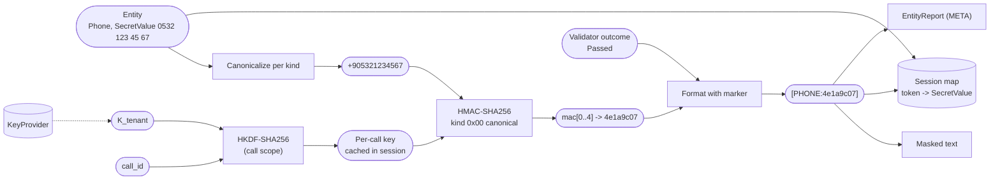
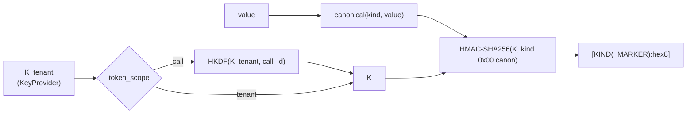

# 13. Keyed tokenization

## Purpose

Replace a detected value with a short, deterministic token that (1) cannot be reversed without a secret key, (2) is stable for the same value within its scope, so that references across a conversation stay consistent, and (3) tells an LLM whether the value was valid.

## Where it runs

| | |
|---|---|
| Pipeline stage | Transform |
| Crate | `ortu-crypto` |
| Modes | Realtime and PostCall |

## Inputs and outputs

- Input: `Entity` (kind, `SecretValue`, validator outcome), tenant id, call id, token scope.
- Output: `Token` (string form below); in Realtime the pair `(Token, SecretValue)` is inserted into the session map ([15](15-rehydration-and-provenance.md)).

## Data flow



| From | Data | To |
|---|---|---|
| 11 | `Entity` with `SecretValue` and validator outcome | canonicalizer, formatter |
| KeyProvider | `K_tenant` | HKDF (call scope) or HMAC directly (tenant scope) |
| Session | `call_id`, cached per-call key | HKDF |
| This step | Token string | masked text, `EntityReport`, vault record key (14) |
| This step | `(token, SecretValue)` | session map (15) |

## Algorithm

### Key derivation

```
K_tenant = key_provider.token_key(tenant_id)              # 256-bit secret

if token_scope == "call":
    K = HKDF-SHA256(ikm = K_tenant,
                    salt = "ortu/token/v1",
                    info = call_id)                        # per-call key
else:   # "tenant"
    K = K_tenant
```

### Token computation

```
canon = canonical(kind, value)
mac   = HMAC-SHA256(K, kind_label || 0x00 || canon)
hex8  = lowercase_hex(mac[0..4])                           # 32 bits
token = "[" + kind_label + marker + ":" + hex8 + "]"

marker = ""            if validator == Passed or NotApplicable
       = "_INCOMPLETE" if validator == Failed(length too short)
       = "_INVALID"    otherwise
```

The `0x00` separator prevents ambiguity between `kind_label` and `canon` (no kind label contains a NUL byte).

### Canonicalization per kind

| Kind | Canonical form | Example input | Canonical |
|---|---|---|---|
| `Tckn`, `Vkn`, `CreditCard` | digits only | `100 000 001 46` | `10000000146` |
| `Iban` | uppercase, no spaces | `tr96 0006 1000 ...` | `TR96000610...` |
| `Phone` | E.164 | `0532 123 45 67` | `+905321234567` |
| `PersonName`, `FullName` | Turkish case fold, single spaces | `AHMET  Yılmaz` | `ahmet yılmaz` |
| `Email` | lowercase | `Ahmet.Yilmaz@Example.com` | `ahmet.yilmaz@example.com` |
| `Plate` | uppercase, single spaces | `34abc123` | `34 ABC 123` |

### Collisions

Within one call, 32 bits make a collision negligible (a call contains a handful of entities). With tenant scope and a vault, the vault checks uniqueness on insert; on a collision the token for the new value is issued with 64 bits (`hex16`). Rehydration accepts both lengths.



## Worked example (illustrative)

| Input | Canonical | Validator | Token |
|---|---|---|---|
| `0532 123 45 67` | `+905321234567` | Passed | `[PHONE:4e1a9c07]` |
| `beş yüz otuz iki yüz yirmi üç kırk beş altmış yedi` | `+905321234567` | Passed | `[PHONE:4e1a9c07]` (same) |
| 9 digits after a TCKN cue | `100000001` | Failed(length) | `[TCKN_INCOMPLETE:b20c5d11]` |

The hex values above are illustrative. The test vectors in `crates/ortu-crypto/src/token.rs` (key bytes `0x00..0x1f`) were computed by an independent Python implementation (HKDF written from RFC 5869): `10000000146` gives `[TCKN:6bc297fb]` under tenant scope, `[TCKN:df1c492e]` in call `call-42` and `[TCKN:4501f8c7]` in call `call-43`; `+905321234567` gives `[PHONE:ebfa358c]` in call `call-42`.

## Complexity

One HMAC per entity (microseconds); one HKDF per call, cached in the session.

## Edge cases

- **Missing key:** if the `Token` or `Encrypt` strategy is configured and `token_key` fails, the engine refuses to start; at runtime, a key failure triggers the fail mode (`Block` by default).
- **Same value, different kinds:** a number recognized once as `Phone` and once as `Vkn` yields different tokens by design (the kind is part of the MAC input).
- **Key rotation:** rotating `K_tenant` changes all tenant-scoped tokens. Tenant-scoped analytics must record the key version alongside tokens.

## Design rationale

- **HMAC instead of a plain hash:** the input spaces are tiny (10^10 for TCKN); an unkeyed hash can be inverted by enumeration in seconds.
- **Call scope by default:** prevents linking the same person across calls, which is the privacy-preserving default. Linking is a deliberate opt-in for analytics.
- **32-bit display length:** short tokens survive LLM context better and cost fewer tokens; uniqueness only needs to hold within the scope.
- **Validity marker in the token:** the LLM cannot inspect the value; the marker is the only way it can know to ask again.

## Tests and invariants

- Determinism: same key, kind and canonical value give the same token.
- Independent vectors for tenant scope, call scope, every M2 kind and the `_INCOMPLETE` marker.
- Different call ids give different tokens under call scope.
- Every canonicalization rule has a table-driven test.
- No token computation path can run without a key (type-level: `Tokenizer::new` requires a `SecretKey`).
