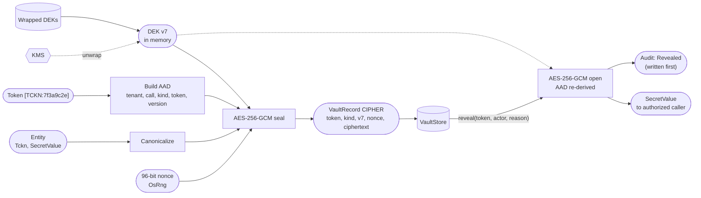
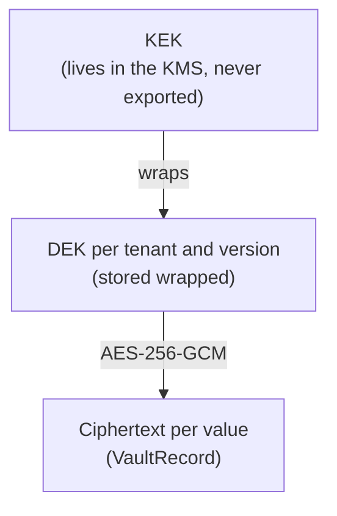
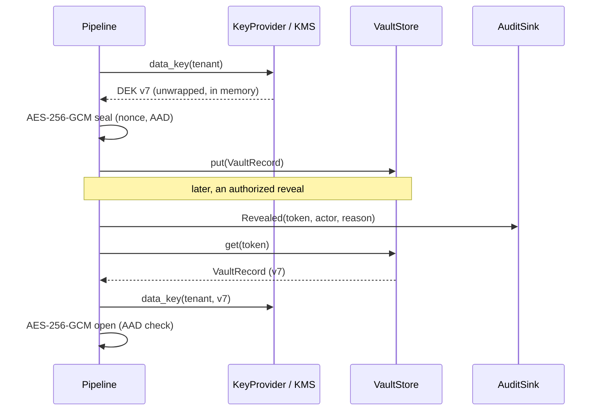

# 14. Envelope encryption

## Purpose

Store detected values encrypted, so that an authorized party can recover them later through an audited `reveal`, and so that destroying a key makes the data permanently unreadable (crypto-shredding).

## Where it runs

| | |
|---|---|
| Pipeline stage | Transform (`Encrypt` strategy only) |
| Crate | `ortu-crypto` |
| Modes | PostCall (persistent data only) |

## Data flow



| From | Data | To |
|---|---|---|
| 11, 13 | Entity value, token | seal |
| KMS | Unwrapped DEK (per tenant, version) | seal, open |
| This step | `VaultRecord` (CIPHER) | `VaultStore` |
| `reveal` | Token, actor, reason | open; audit sink before returning |
| `shred_call` / `destroy(version)` | Call id / key version | `VaultStore` delete / KMS key destruction |

## Key hierarchy



## Algorithm

### Encrypt

```
encrypt(entity, token, tenant, call):
    (dek, version) = key_provider.data_key(tenant, None)    # unwrapped via the KMS, cached briefly
    nonce = random 96 bits from OsRng
    aad = tenant_id || call_id || kind || token || version  # length-prefixed fields
    ct = AES-256-GCM.seal(dek, nonce, plaintext = canonical(value), aad)
    vault.put(VaultRecord { token, kind, key_version: version, nonce, ciphertext: ct,
                            created_at, call_id })
    dek.counter += 1
    if dek.counter >= ROTATE_AT: schedule rotation         # well below 2^32 messages
```

AAD fields are length-prefixed, not just concatenated, so that `("ab", "c")` and `("a", "bc")` can never produce the same AAD.

### Reveal

```
reveal(token, actor, reason):
    require actor has the reveal permission
    require reason is non-empty
    rec = vault.get(tenant, token) or NotFound
    dek = key_provider.data_key(tenant, Some(rec.key_version))
    pt = AES-256-GCM.open(dek, rec.nonce, rec.ciphertext, aad(rec))   # fails if any AAD field changed
    audit(Revealed { token, actor, reason, ts })                      # written before returning
    return SecretValue(pt)
```

### Shred

```
shred_call(tenant, call):     vault.delete where call_id == call; audit(Shredded)
shred_period(tenant, version): key_provider.destroy(tenant, version)  # all ciphertext of that version is gone
```



## Complexity

One AEAD operation per value; DEK unwrapping is cached per tenant and version for a short TTL to avoid a KMS round trip per value.

## Edge cases

- **Moved ciphertext:** copying a record to another call or tenant changes the AAD, so decryption fails.
- **Reveal audit failure:** if the audit sink is unavailable, `reveal` fails (fail-closed). A reveal without an audit record must not exist.
- **Rotation:** new values use the newest DEK version; old records keep their version and remain decryptable until that version is destroyed.

## Design rationale

- **Envelope encryption instead of encrypting with a KMS directly:** per-value KMS calls would be slow and expensive; a cached DEK keeps encryption local while the KEK never leaves the KMS.
- **Random nonces with a message budget:** simpler than counters across processes; the budget keeps the nonce-collision probability negligible.
- **Destroying keys instead of deleting rows for period erasure:** backups and replicas may still hold rows; without the key, those copies are unreadable as well.

## Tests and invariants

- Round trip: `reveal(encrypt(v)) == v` (proptest).
- Changing any AAD field makes decryption fail.
- `reveal` without a reason, or without permission, fails before touching the vault.
- No code path writes plaintext to the vault or to logs.
