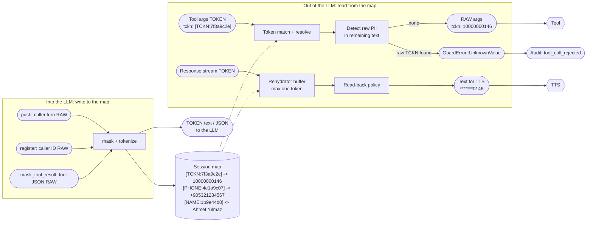
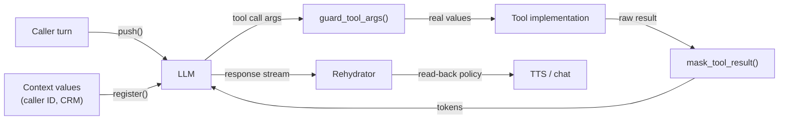
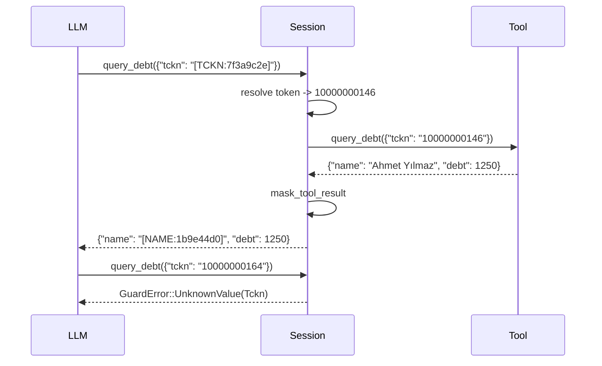

# 15. Rehydration and provenance

## Purpose

Let an LLM work with tokens while the systems around it still get real values where they genuinely need them, and make sure that a value the LLM invents or corrupts **never** reaches an external system.

## Where it runs

| | |
|---|---|
| Pipeline stage | LLM loop (after Transform) |
| Crate | `ortu-stream` (`matcher.rs`, `map.rs`, `tools.rs`, `rehydrate.rs`) |
| Modes | Realtime |

## Data flow

The session map is the hub: everything that enters the LLM writes to it, everything that leaves the LLM reads from it.



| From | Data | To |
|---|---|---|
| Adopter (`push`, `register`, `mask_tool_result`) | RAW turns, context values, tool results | tokenizer (13); session map |
| This step | TOKEN text and JSON | LLM (via adopter) |
| LLM (via adopter) | Tool arguments (TOKEN) | `guard_tool_args` |
| `guard_tool_args` | RAW arguments, or `GuardError` | tool implementation, or back to the agent |
| LLM (via adopter) | Response stream (TOKEN) | `Rehydrator`, then TTS / chat |
| Every guard decision | META event | audit sink |

## The four boundaries



Every arrow into the LLM carries tokens only; every arrow out of the LLM toward the outside world passes through a guard.

| Boundary | API | Direction | What happens |
|---|---|---|---|
| Caller speech | `push(turn)` | into LLM | Mask, insert `(token, value)` into the session map |
| Context values | `register(kind, value)` | into LLM | Adopter-supplied PII (caller ID, CRM fields) gets a token before it is placed in a prompt |
| Tool results | `mask_tool_result(tool, json)` | into LLM | Values returned by tools are masked and registered |
| Tool arguments | `guard_tool_args(tool, json)` | out of LLM | Tokens replaced by real values; raw PII rejected |
| Response text | `rehydrate(text)` / `Rehydrator` | out of LLM | Tokens replaced according to the read-back policy |

## Algorithm

### Tolerant token matching

LLMs corrupt tokens: they drop brackets, change case, insert spaces or put the token inside quotes. The matcher accepts these forms but requires a known label and the full digest. The grammar is bounded and ASCII-only (ADR-0008):

```
( "[" WS{0,3} )? LABEL ( "_INCOMPLETE" | "_INVALID" )? WS{0,3} ( ":" | "：" )?
WS{0,3} ( HEX{16} | HEX{8} ) ( WS{0,3} "]" )?

LABEL: TCKN | VKN | IBAN | PHONE | CARD | EMAIL | NAME | ADDRESS | PLATE | BIRTHDATE | PASSPORT
       (and the labels of adopter kinds), ASCII case-insensitive; WS: space or tab
```

Without its opening bracket, a token must not follow a letter, digit or underscore (`USERNAME:55832c68` is not a `NAME` token); without its closing bracket, it must not be followed by one (`TCKN:df1c492e5` is not a token). Unicode case folding is excluded: it would let `K` (Kelvin sign) match `K`.

Resolution:

```
resolve(match):
    slot = session.map.get(label, digest)       # keyed by label and digest
    One(entry)  -> entry.value
    Ambiguous   -> Err(GuardError::AmbiguousToken)   # two values share the token
    missing     -> Err(GuardError::UnknownToken)     # never pass through, never guess
```

A token whose digest was altered by one character does **not** match a neighbor; it fails. This is what guarantees that rehydration never returns a wrong value. Digests are not secrets (the LLM holds every token it can present), so the lookup needs no constant-time comparison.

### Provenance check on tool arguments

```
guard_tool_args(tool, args):
    out = copy of args
    for each string or number leaf s in out, with the field name f above it:
        # 1. Replace tokens.
        for m in token_matches(s):
            entry = resolve(m)?                             # ? propagates GuardError
            if entry is incomplete or invalid and not accepts_invalid(tool, entry.kind):
                return Err(GuardError::InvalidValue)
            replace m with entry.value
        # 2. Look for raw PII that did not come from a token.
        hint = field_kind(f) if it is an identifier kind (`tckn`, `phoneNumber`, `iban`)
        for e in analyze(s with the tokens removed, expecting = hint):
            if e.score >= mask_threshold:
                return Err(GuardError::UnknownValue { kind: e.kind })
    audit(ToolArgsReleased { tool, kinds })?                # no audit, no release
    return out
```

Every rejection is audited too (`tool_call_rejected` with its reason); a sink failure there does not hide the reason. JSON numbers are checked like strings: `{"tckn": 10000000164}` is rejected.

`mask_tool_result` walks the result the same way and masks what it finds, with the field name as a cue for every kind: `{"name": "Ahmet Yılmaz"}` is read like an answer to "adınız?", so the name is masked without an introducer. `register` canonicalizes the value first (digits, E.164, compact IBAN), so a registered caller ID and the same number spoken later share one token.

Why step 2 is a hard rejection: the LLM only ever saw tokens. Caller speech, context values and tool results all enter the LLM through `push`, `register` or `mask_tool_result`. A raw TCKN in a tool argument can therefore only be a value the LLM produced itself, by invention or by corrupting a token it misread. Releasing it could query another person's record.



### Streaming rehydration

```
Rehydrator.feed(chunk):
    buf += chunk
    k = earliest index in the last MAX_TOKEN_LEN bytes of buf
        from which buf[k..] could still grow into a token (or a longer one)
    ready = buf[..k]; buf = buf[k..]
    emit(rehydrate(ready, before = last released char, after = first char of buf))

Rehydrator.finish():
    emit(rehydrate(buf, before = last released char, after = none))
```

"Could still grow" is decided exactly by walking the bounded grammar: `[TCK`, `TCKN:` and `TCKN:df1c492e` can; `[TCKN:df1c492e]` and `TCKN:df1c492e.` cannot. Only such a suffix is ever buffered (at most one token length); all other text passes through immediately, so TTS latency is unaffected. The characters around each released piece go to the matcher, so the boundary rules give the same answer as on the whole text. `RehydrateStream` holds the buffer without borrowing the session, for bindings.

### Read-back policy

| Kind | Default read-back |
|---|---|
| `PersonName`, `PersonSurname`, `FullName` | Full value (the agent addresses the caller by name) |
| `Address` | Full value |
| Every other kind (`Tckn`, `CreditCard`, `Phone`, `Iban`, ...) | Partially masked (`*******0146`) |

`EngineBuilder::read_back(kind, ReadBack::Full)` overrides a kind. Names are stored with their source spelling (`Ahmet Yılmaz`); their token is computed over the folded form.

## Lifecycle of the session map

- Created with the session; holds `(label, digest) -> (kind, SecretValue, validator outcome)`. Two different values under one key make it ambiguous.
- Written by `push` (token transforms only), `register` and `mask_tool_result`; read by `guard_tool_args` and `rehydrate`.
- Never serialized, logged or written to a shared store.
- Zeroized when the session is dropped, which `finish()` does. Deployments disable core dumps; `mlock` is recommended.

## Complexity

Token matching is a single linear-time regex pass; map lookups are O(1). `guard_tool_args` runs the Text-channel detectors over argument strings, which are short.

## Edge cases

- **The LLM paraphrases a token** ("the number you gave me"): nothing to rehydrate; the text passes through.
- **The LLM copies a token into a field that expects a different kind:** the token resolves to its own kind; schema validation of the tool is the adopter's responsibility, but the audit event records the mismatch.
- **Public numbers in arguments** (a municipal call-center number): detectors do not treat 444 numbers or configured public numbers as PII, so they pass.
- **Server deployment:** the map lives in the server's memory; mTLS and session TTLs apply (design document §10.8).

## Design rationale

- **Fail on unknown tokens instead of passing them through:** passing `[TCKN:7f3a9c2f]` to a tool is harmless; passing a guess is not. Failing loudly also surfaces LLM corruption rates in metrics.
- **Rejection instead of correction for raw PII:** "correcting" an LLM-invented TCKN to the closest known one would be guessing. A rejected tool call is recoverable (the agent asks again); a wrong record lookup is not.
- **Masking tool results:** without it, a tool would become a side channel that feeds raw PII into the LLM context and, from there, into the provider's logs.

## Tests and invariants

In `crates/ortu-stream/tests/`:

- Proptest: randomly corrupted tokens (case, brackets, spaces, one altered digest digit) either resolve to the correct value or fail; never to another value.
- Proptest: any valid TCKN, IBAN or phone number not in the map is rejected in tool arguments.
- Proptest: streaming rehydration over random chunk boundaries equals non-streaming rehydration, including unknown tokens, unbracketed tokens and letters glued to them. This property found a defect during M3: a token at the end of a released piece was judged without the character that followed it in the buffer.
- Every guard decision emits an audit event (`tool_call_rejected` or `tool_args_released`) without raw values; releasing fails when the sink fails.
- Fuzz targets `rehydrate` and `redact_pipeline`; on Windows, the session stress test of `cargo xtask fuzz`.
