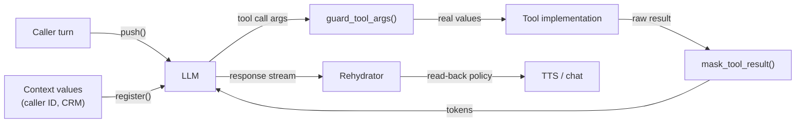
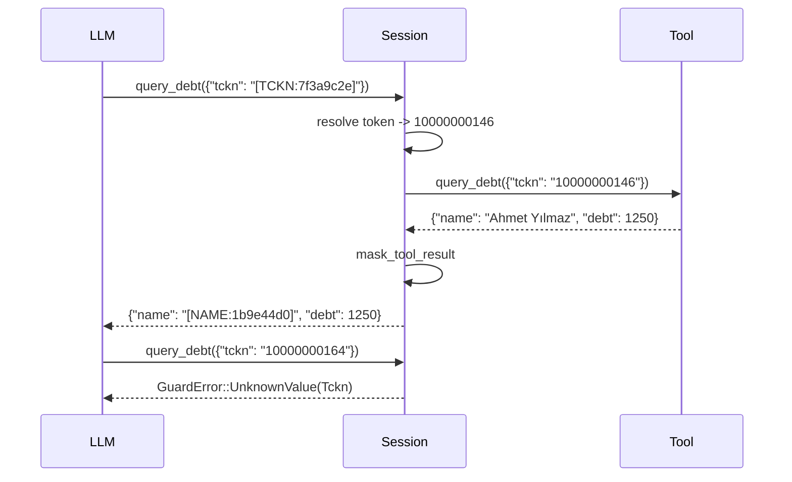

# 15. Rehydration and provenance

## Purpose

Let an LLM work with tokens while the systems around it still get real values where they genuinely need them, and make sure that a value the LLM invents or corrupts **never** reaches an external system.

## Where it runs

| | |
|---|---|
| Pipeline stage | LLM loop (after Transform) |
| Crate | `ortu-stream` |
| Modes | Realtime |

## Data flow

The session map is the hub: everything that enters the LLM writes to it, everything that leaves the LLM reads from it.


| From | Data | To |
|---|---|---|
| Adopter (`push`, `register`, `mask_tool_result`) | RAW turns, context values, tool results | tokenizer (13); session map |
| This step | TOKEN text and JSON | LLM (via adopter) |
| LLM (via adopter) | Tool arguments (TOKEN) | `guard_tool_args` |
| `guard_tool_args` | RAW arguments, or `GuardError` | tool implementation, or back to the agent |
| LLM (via adopter) | Response stream (TOKEN) | `Rehydrator`, then TTS / chat |
| Every guard decision | META event | audit sink |

## The four boundaries



Every arrow into the LLM carries tokens only; every arrow out of the LLM toward the outside world passes through a guard.

| Boundary | API | Direction | What happens |
|---|---|---|---|
| Caller speech | `push(turn)` | into LLM | Mask, insert `(token, value)` into the session map |
| Context values | `register(kind, value)` | into LLM | Adopter-supplied PII (caller ID, CRM fields) gets a token before it is placed in a prompt |
| Tool results | `mask_tool_result(tool, json)` | into LLM | Values returned by tools are masked and registered |
| Tool arguments | `guard_tool_args(tool, json)` | out of LLM | Tokens replaced by real values; raw PII rejected |
| Response text | `rehydrate(text)` / `Rehydrator` | out of LLM | Tokens replaced according to the read-back policy |

## Algorithm

### Tolerant token matching

LLMs corrupt tokens: they drop brackets, change case, insert spaces or put the token inside quotes. The matcher accepts these forms but requires the kind label and the full hex part:

```
(?i) \[? \s* (TCKN|VKN|IBAN|PHONE|NAME|EMAIL|ADDRESS|PLATE|...)
     (?: _(INCOMPLETE|INVALID) )? \s* [:：]? \s*
     ([0-9a-f]{8}|[0-9a-f]{16}) \s* \]?
```

Resolution:

```
resolve(match):
    entry = session.map.get(kind, hex)          # constant-time comparison
    if entry exists: return entry.value
    else:            return Err(GuardError::UnknownToken)   # never pass through, never guess
```

A token whose hex part was altered by one character does **not** match a neighbor; it fails. This is what guarantees that rehydration never returns a wrong value.

### Provenance check on tool arguments

```
guard_tool_args(tool, args):
    out = deep copy of args
    for each string leaf s in out:
        # 1. Replace tokens.
        for m in token_matches(s):
            replace m with resolve(m)?                      # ? propagates GuardError
            if m.marker in {INCOMPLETE, INVALID} and not tool.allows_invalid(m.kind):
                return Err(GuardError::InvalidValue)
        # 2. Look for raw PII that did not come from a token.
        for c in detect(original_leaf_without_tokens, channel = Text):
            if c.score >= mask_threshold:
                return Err(GuardError::UnknownValue { kind: c.kind })
    audit(ToolArgsReleased { tool, kinds })
    return out
```

Why step 2 is a hard rejection: the LLM only ever saw tokens. Caller speech, context values and tool results all enter the LLM through `push`, `register` or `mask_tool_result`. A raw TCKN in a tool argument can therefore only be a value the LLM produced itself, by invention or by corrupting a token it misread. Releasing it could query another person's record.



### Streaming rehydration

```
Rehydrator.feed(chunk):
    buf += chunk
    k = earliest index in buf where a token match could still begin
        (a '[' or a prefix of a kind label, case-insensitive)
    if no such index: emit(buf); buf = ""; return
    emit(rehydrate(buf[..k])); buf = buf[k..]
    if buf contains a complete match: emit(rehydrate(match)); buf = rest
    if len(buf) > MAX_TOKEN_LEN + TOLERANCE: emit(buf[..1]); buf = buf[1..]   # not a token after all

Rehydrator.finish():
    emit(rehydrate(buf))
```

Only a possible token prefix is ever buffered (at most about 30 characters); all other text passes through immediately, so TTS latency is unaffected.

### Read-back policy

| Kind | Default read-back |
|---|---|
| `Tckn`, `CreditCard` | Partially masked (`*******0146`), never the full value |
| `Phone` | Partially masked |
| `PersonName`, `FullName` | Full value (the agent addresses the caller by name) |
| `Address` | Full value |
| Others | Configurable per tenant |

## Lifecycle of the session map

- Created with the session; holds `(kind, hex) -> SecretValue`.
- Never serialized, logged or written to a shared store.
- Zeroized on `finish()` or `drop`. Deployments disable core dumps; `mlock` is recommended.

## Complexity

Token matching is a single linear-time regex pass; map lookups are O(1). `guard_tool_args` runs the Text-channel detectors over argument strings, which are short.

## Edge cases

- **The LLM paraphrases a token** ("the number you gave me"): nothing to rehydrate; the text passes through.
- **The LLM copies a token into a field that expects a different kind:** the token resolves to its own kind; schema validation of the tool is the adopter's responsibility, but the audit event records the mismatch.
- **Public numbers in arguments** (a municipal call-center number): detectors do not treat 444 numbers or configured public numbers as PII, so they pass.
- **Server deployment:** the map lives in the server's memory; mTLS and session TTLs apply (design document §10.8).

## Design rationale

- **Fail on unknown tokens instead of passing them through:** passing `[TCKN:7f3a9c2f]` to a tool is harmless; passing a guess is not. Failing loudly also surfaces LLM corruption rates in metrics.
- **Rejection instead of correction for raw PII:** "correcting" an LLM-invented TCKN to the closest known one would be guessing. A rejected tool call is recoverable (the agent asks again); a wrong record lookup is not.
- **Masking tool results:** without it, a tool would become a side channel that feeds raw PII into the LLM context and, from there, into the provider's logs.

## Tests and invariants

- Proptest: randomly corrupted tokens either resolve to the correct value or fail; never to another value.
- Proptest: any valid TCKN, IBAN or phone number not in the map is rejected in tool arguments.
- Proptest: streaming rehydration over random chunk boundaries equals non-streaming rehydration.
- Every guard decision emits an audit event (`tool_call_rejected` or `tool_args_released`) without raw values.
