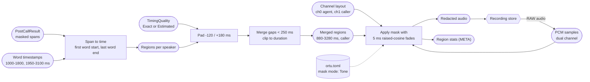

# 16. Audio redaction

## Purpose

Cover every masked entity in the call recording with a beep, silence or noise, using the word timestamps from STT, without audible clicks and without leaving a syllable of PII outside the covered region.

## Where it runs

| | |
|---|---|
| Pipeline stage | Redact audio |
| Crate | `ortu-audio` |
| Modes | PostCall only |
| Channels | Speech only |

## Inputs and outputs

- Input: `PostCallResult.audio_regions` (derived from masked spans), the recording (PCM), channel layout, `TimingQuality`.
- Output: the redacted recording (WAV or Opus) and region statistics.

## Data flow



| From | Data | To |
|---|---|---|
| 12 (`finish`) | Masked spans, `AudioRegion[]` | span-to-time mapper |
| STT via `push` | Word timestamps, `TimingQuality` | mapper, padding |
| Recording store | RAW PCM, channel layout | masking step |
| `ortu.toml` | Mask mode, padding, merge gap | masking step |
| This step | Redacted recording | recording store (replaces the original under adopter policy) |
| This step | Region statistics | metrics, evaluation |

## Algorithm

```
redact_audio(regions, pcm, layout):
    # 1. Span -> time
    for e in masked entities:
        start = words[e.first_word].start_ms
        end   = words[e.last_word].end_ms
        regions.push(Region { start, end, speaker: e.speaker })

    # 2. Padding (end-of-speech tails are longer than onsets)
    pad_before, pad_after = 120 ms, 180 ms
    if timing == Estimated: pad_before *= 2.5; pad_after *= 2.5
    region.start -= pad_before; region.end += pad_after

    # 3. Merge per speaker channel: overlapping or gap < 250 ms
    sort regions by start
    merged = []
    for r in regions:
        if merged.last and r.start - merged.last.end < 250 ms: merged.last.end = max(...)
        else: merged.push(r)

    # 4. Clip to [0, duration]

    # 5. Apply mask with crossfade on the target channel(s)
    for r in merged:
        channels = [r.speaker's channel] if layout is dual-channel else all
        for sample t in r, for ch in channels:
            g = fade_gain(t, r)                 # 0 -> 1 over 5 ms at the start, 1 -> 0 at the end
            out[t, ch] = (1 - g) * in[t, ch] + g * mask(t)
```

Raised-cosine fade over `T = 5 ms`:

```
fade_in(x)  = 0.5 * (1 - cos(pi * x / T)),   0 <= x <= T
fade_out(x) = 0.5 * (1 + cos(pi * x / T)),   0 <= x <= T
```

Mask signals:

| Mode | Signal |
|---|---|
| `Tone` (default) | 1 kHz sine at -20 dBFS |
| `Silence` | 0 |
| `Noise` | pink noise at -30 dBFS |

```mermaid
gantt
    title One masked TCKN (caller channel)
    dateFormat x
    axisFormat %L ms
    section Words
    "on sıfır sıfır"        :w1, 1000, 1800
    "sıfır yüz kırk altı"   :w2, 1950, 3100
    section Regions
    Padded region 1         :r1, 880, 1980
    Padded region 2         :r2, 1830, 3280
    section Output
    Merged (gap < 250 ms)   :crit, m1, 880, 3280
```



## Worked example

| Step | Region 1 | Region 2 |
|---|---|---|
| Word timestamps | 1000-1800 ms | 1950-3100 ms |
| Padded (-120 / +180) | 880-1980 ms | 1830-3280 ms |
| Merged (overlap) | 880-3280 ms | |
| Fade-in | 880-885 ms | |
| Fade-out | 3275-3280 ms | |

## Complexity

O(R log R) for merging R regions; O(S) over the samples inside regions. The target is more than 200x real time.

## Edge cases

- **Timestamp drift:** STT timestamps can be off by 100 to 300 ms. Padding values are calibrated in M7 against synthetic TTS audio with known alignments, and the audio leak rate is reported.
- **Mono recordings:** both speakers are masked in the region; agent speech overlapping a caller's PII is lost by design.
- **Streaming media pipelines:** regions are applied in place to PCM chunks as they arrive; a region spanning a chunk boundary carries its fade state across chunks.
- **Resampled or transcoded recordings:** timestamps refer to the original timeline; any offset introduced by the recording pipeline must be supplied as `offset_ms`.

## Design rationale

- **Asymmetric padding:** speech tails (final syllables, breaths) extend further than onsets; symmetric padding either leaks tails or wastes audio at the start.
- **Merging short gaps:** a single unmasked digit between two masked regions is a leak; 250 ms is shorter than one spoken digit in normal speech.
- **Beep by default:** listeners can tell that something was removed, which matters for quality review and dispute handling; silence can be mistaken for a dropped call.
- **Per-speaker channels:** in dual-channel recordings, masking only the caller keeps the agent's speech intact for quality review.

## Tests and invariants

- Region boundaries are accurate to within one sample on synthetic WAV files.
- No click at region edges (spectral energy above a threshold at the boundary fails the test).
- Every merged region contains every source region (superset invariant).
- Benchmark: more than 200x real time on a single core.
