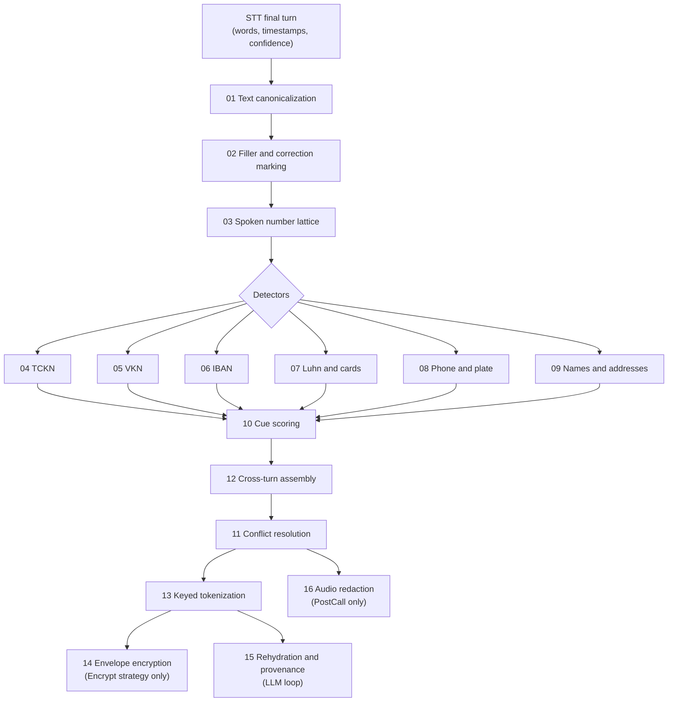

# Algorithms

This directory documents every algorithm in ortu, one file each. The design document ([systemdesign.md](../systemdesign.md)) defines *what* the system does; these documents define *how* each step works, *where* it runs, and *why* it was built that way.

For where each piece of data comes from and where it goes, see [data-flow.md](../data-flow.md).

## Pipeline map

## Index

| # | Algorithm | Pipeline stage | Crate | Runs in |
|---|---|---|---|---|
| 01 | [Text canonicalization](01-text-canonicalization.md) | Normalize | `ortu-normalize` | Realtime, PostCall |
| 02 | [Filler and correction marking](02-filler-and-correction-marking.md) | Normalize | `ortu-normalize` | Realtime, PostCall |
| 03 | [Spoken number lattice](03-spoken-number-lattice.md) | Normalize | `ortu-normalize` | Realtime, PostCall |
| 04 | [TCKN validation](04-tckn-validation.md) | Detect, Validate | `ortu-tr` | Realtime, PostCall |
| 05 | [VKN validation](05-vkn-validation.md) | Detect, Validate | `ortu-tr` | Realtime, PostCall |
| 06 | [IBAN validation](06-iban-validation.md) | Detect, Validate | `ortu-tr` | Realtime, PostCall |
| 07 | [Luhn and card detection](07-luhn-and-card-detection.md) | Detect, Validate | `ortu-tr` | Realtime, PostCall |
| 08 | [Phone and plate detection](08-phone-and-plate-detection.md) | Detect, Validate | `ortu-tr` | Realtime, PostCall |
| 09 | [Name and address detection](09-name-and-address-detection.md) | Detect | `ortu-tr` | Realtime, PostCall |
| 10 | [Cue scoring](10-cue-scoring.md) | Score context | `ortu-core` | Realtime, PostCall |
| 11 | [Conflict resolution](11-conflict-resolution.md) | Resolve, Decide | `ortu-core` | Realtime, PostCall |
| 12 | [Cross-turn assembly](12-cross-turn-assembly.md) | Assemble | `ortu-stream` | Realtime, PostCall |
| 13 | [Keyed tokenization](13-keyed-tokenization.md) | Transform | `ortu-crypto` | Realtime, PostCall |
| 14 | [Envelope encryption](14-envelope-encryption.md) | Transform | `ortu-crypto` | PostCall |
| 15 | [Rehydration and provenance](15-rehydration-and-provenance.md) | LLM loop | `ortu-stream` | Realtime |
| 16 | [Audio redaction](16-audio-redaction.md) | Redact audio | `ortu-audio` | PostCall |

## Document structure

Every algorithm document follows the same outline, so reviewers know where to look:

1. **Purpose**: the problem the algorithm solves.
2. **Where it runs**: pipeline stage, crate, processing modes.
3. **Inputs and outputs**: types at the boundary.
4. **Algorithm**: pseudocode or exact formulas.
5. **Worked example**: a step-by-step trace on synthetic data.
6. **Complexity**: time and memory.
7. **Edge cases**: inputs that are known to be hard.
8. **Design rationale**: alternatives considered and why they were rejected.
9. **Tests and invariants**: what the test suite must prove.

All example values are synthetic. A checksum-valid example may still coincide with a real person's number; examples never carry names or context that could tie them to anyone.

Diagrams use Mermaid, which renders natively on GitHub and in the mdBook site (via `mdbook-mermaid`).
