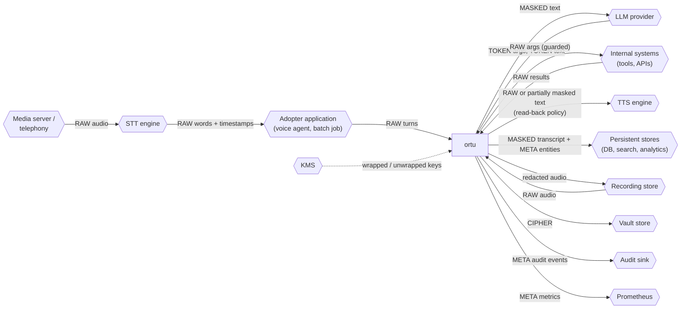
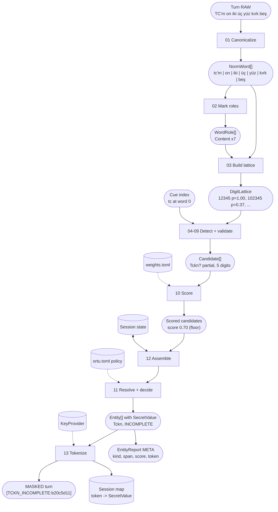
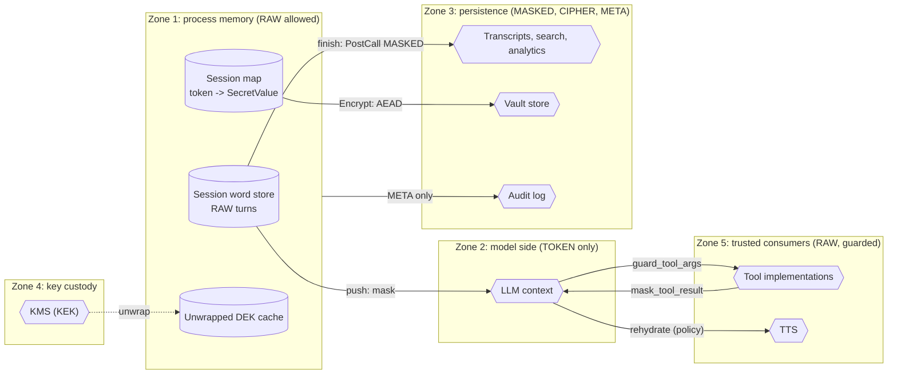
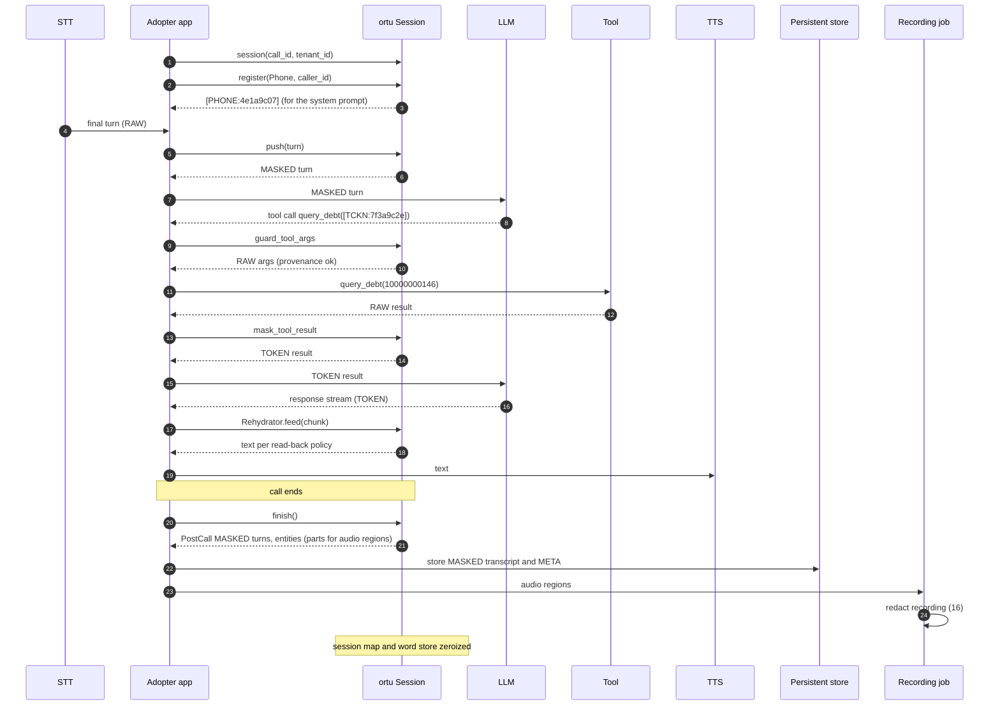
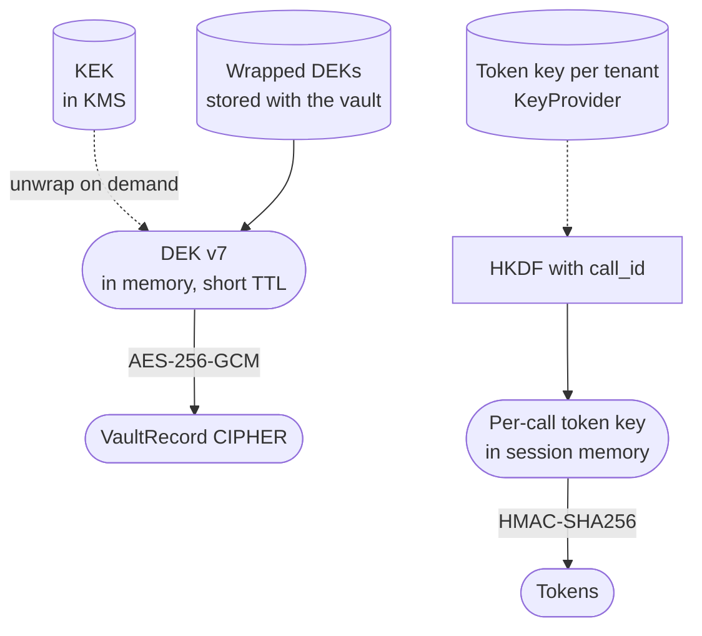

# Data flow

This document maps every piece of data ortu touches: **where it comes from, what form it is in, where it goes, through which API, and how long it lives.** It is the reference for security reviews and for anyone integrating ortu.

Related documents: [systemdesign.md](systemdesign.md) (what the system does), [algorithms/](algorithms/README.md) (how each step works).

## Legend

All diagrams use the same shapes:

| Shape | Meaning |
|---|---|
| `([ rounded ])` | A piece of data, with an example value where useful |
| `[ rectangle ]` | A processing step inside ortu |
| `[( cylinder )]` | A store (memory map, database, KMS) |
| `{{ hexagon }}` | An external system ortu does not control |
| Solid arrow | Data flow |
| Dotted arrow | Configuration or key material read |

Data forms:

| Form | Meaning |
|---|---|
| **RAW** | Plaintext personal data |
| **TOKEN** | Keyed token such as `[TCKN:7f3a9c2e]`; no raw value |
| **MASKED** | Text in which every detected value is a token, a mask or a redaction marker |
| **CIPHER** | AES-256-GCM ciphertext |
| **META** | Kinds, scores, offsets, counts; never raw values |

---

## 1. Context: ortu and the systems around it

Out of ortu's control: the media server, STT and the transfer of raw audio to STT. If STT runs in the cloud, raw audio has left before ortu sees anything (design document §2).

---

## 2. Inside ortu: one turn, step by step

What enters and leaves each pipeline stage, using one caller turn as the example.

At the end of this flow:

| Output | Form | Goes to |
|---|---|---|
| Masked turn | MASKED | LLM (Realtime) |
| Session map entry | RAW, in memory | Stays in the session until `finish()` |
| Entity report | META | Caller of `push` (for dashboards, review) |
| Raw turn | RAW | Kept in the session word store until `finish()`; never returned |

---

## 3. Trust zones

Every piece of data lives in exactly one zone. Arrows between zones are the only allowed crossings.

**Forbidden crossings** (each one is enforced, not just documented):

| Forbidden | Enforced by |
|---|---|
| RAW into Zone 2 (LLM) | All inputs to the LLM pass `push`, `register` or `mask_tool_result` |
| Realtime output into Zone 3 | `RealtimeOutput` has no persistence conversion; only `PostCallResult` implements the persistence traits |
| RAW into logs, metrics, audit | `SecretValue` has no `Display`/`Serialize`; log-leak test in the test suite (design document §12) |
| Session map to disk or network | The map type implements neither `Serialize` nor `Clone` |
| Unknown or invented value into Zone 5 | Provenance check in `guard_tool_args` ([15](algorithms/15-rehydration-and-provenance.md)) |
| KEK out of Zone 4 | ortu only ever calls wrap/unwrap; it never requests key export |

---

## 4. Data inventory

| # | Data | Form | Comes from | Goes to | API | Lifetime | Persisted by ortu |
|---|---|---|---|---|---|---|---|
| D1 | Turn words, timestamps, confidence | RAW | STT via adopter | Session word store | `push`, `redact` | Until `finish()` / end of call | No |
| D2 | Context values (caller ID, CRM fields) | RAW | Adopter | Session map; TOKEN into prompt | `register` | Until `finish()` | No |
| D3 | Tool results | RAW | Internal systems via adopter | Session map; MASKED to LLM | `mask_tool_result` | Until `finish()` | No |
| D4 | Normalized views, lattices, candidates | RAW (transient) | Pipeline | Next pipeline stage | internal | One pipeline run | No |
| D5 | Entities with `SecretValue` | RAW | Pipeline | Tokenizer, vault, session map | internal | One pipeline run | No |
| D6 | Session map | RAW | Tokenizer | `guard_tool_args`, `rehydrate` | internal | Until `finish()`; zeroized | No |
| D7 | Realtime masked text | MASKED | `push` | LLM, live dashboards | `push` return | Adopter-defined; must not be persisted | No |
| D8 | LLM tool arguments | TOKEN | LLM via adopter | Tool implementations (RAW after guard) | `guard_tool_args` | One call | No |
| D9 | LLM response text | TOKEN | LLM via adopter | TTS / chat (policy) | `rehydrate`, `Rehydrator` | One response | No |
| D10 | PostCall transcript | MASKED | `finish` | Persistent stores | `finish` return | Adopter retention policy | No (adopter stores it) |
| D11 | Entity reports | META | `push`, `finish` | Review UI, analytics | return values | Adopter retention policy | No |
| D12 | Audio regions | META | Entity parts of `finish` | Audio redaction | derived in M6 | One job | No |
| D13 | Recording | RAW audio in, redacted out | Recording store | Recording store | `audio/redact` | Adopter retention policy | No |
| D14 | Vault records | CIPHER | Encrypt transform | Vault store | `VaultStore::put` | Until shred or key destruction | Yes (through `VaultStore`) |
| D15 | Audit events | META | Guard decisions (M3); mask, reveal and shred with the vault (M5) | Audit sink | `AuditSink::record` | Adopter audit retention | Yes (through `AuditSink`) |
| D16 | Metrics | META | All stages | Prometheus | `/metrics` | Scrape interval | No |
| D17 | Token key `K_tenant` | Key | KeyProvider | Tokenizer | `KeyProvider::token_key` | In memory, zeroized on drop | No |
| D18 | DEK | Key (wrapped at rest) | KMS | Encrypt / reveal | `KeyProvider::data_key` | Short cache TTL, zeroized | No |
| D19 | KEK | Key | KMS | Never leaves the KMS | n/a | KMS-managed | No |

---

## 5. A call, end to end

---

## 6. Key material

| Key | Where it lives | Who can use it | Destroyed by |
|---|---|---|---|
| KEK | KMS only | KMS on behalf of ortu | KMS policy |
| DEK (per tenant, versioned) | Wrapped next to the vault; unwrapped in ortu memory briefly | `ortu-crypto` | Crypto-shredding a period (`destroy` version) |
| Token key (per tenant) | KeyProvider | `ortu-crypto` | Rotation (changes tenant-scoped tokens) |
| Per-call token key | Session memory | The session | `finish()` / drop |

---

## 7. Checklist for integrators

1. Every value you put in an LLM prompt goes through `register` first.
2. Every tool result goes through `mask_tool_result` before it re-enters the LLM context.
3. Every tool call goes through `guard_tool_args`; treat `GuardError` as "ask the user again", never as "retry with the raw value".
4. Persist only `finish()` output, never `push()` output.
5. Call `finish()` on every exit path, including errors and hang-ups.
6. Disable core dumps in the process that hosts sessions.
7. Push the assistant's turns too, as spoken (after read-back): its questions tell ortu what the caller's next turn holds, and its read-back belongs in the persistent transcript, masked.
8. Written input (chat messages, forms) goes through the same session; the Text channel is a first-class input.
